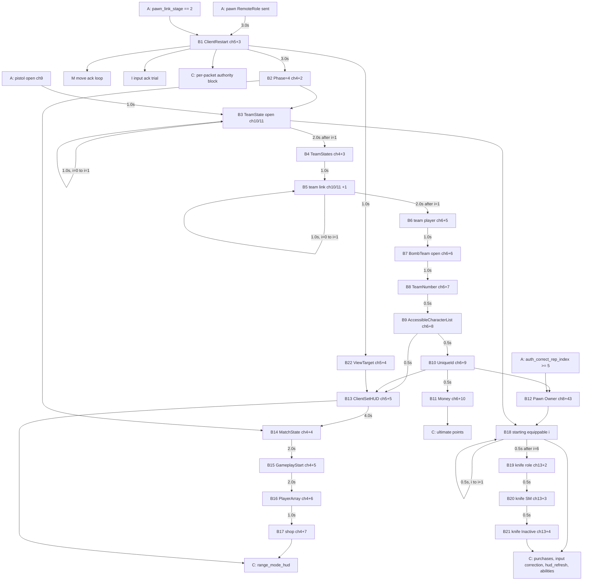

# 04 - Bring-up part B: ClientRestart through the move-ack block

Port spec for the Rust Range server. Source of truth: `local_backend/range_udp_handshake.py` `run_probe`, lines 3353-4535 (the second half of the session-ack stage chain plus the move-ack block), and the input-ack trial at lines 1499-1563. Builders: `range_server_bunch.py`, `range_move_correction.py`, `range_melee_equippable.py`, `range_melee_cosmetics.py`, `range_weapon_cosmetics.py`, `range_abilities.py`. Live-memory helpers: `read_move_number.py`, `capture_input_event_cursor.py`, `resolve_rpc_index.py`, `gameplay_tag_net_index.py`. All line numbers are for the files as of 2026-10-14. File references without a directory are in `local_backend/`.

Production path only. Part A (handshake, session ack, actor opens, links, inventory, pistol, inventory corrections) is in `03_bringup_a.md`; this file references its state but does not re-specify it.

## 0. Corrections to the brief

1. **The steady-state move ack is not field 25.** In production every move ack is `ShooterCharacter.ClientAckInputAndMovement`, field **41**, class max **53** (`build_input_ack_rpc_payload(0xFFFFFFFF, move_number, 41, 53)`, range_udp_handshake.py:4493-4494). Field 25 / max 53 (`--move-ack-index 25 --move-ack-class-max 53`) is `ClientMoveResponsePacked` and is used **once** per connection, for the initial placement correction (`build_correction_rpc_payload`, bAckGoodMove = 0, range_udp_handshake.py:4482-4487). The good-move builder `build_move_response_rpc_payload` (range_server_bunch.py:426-460) is not called by the responder; only `attach_match_state.py` and the unit tests use it.
2. **AccessibleCharacterList has no flag.** The stage at range_udp_handshake.py:3635-3669 fires whenever `bomb_team_number` has been sent. It is production (B9 below).
3. **`session_ack_probe` implies the ack, welcome and join-ack branches.** Each of those branch conditions ORs in `session_ack_probe` (range_udp_handshake.py:2111, 2115, 2143, 2158). Confirmed.
4. **Base-pistol initial cosmetic trial path.** `launch.ps1:189-192` adds `--base-pistol-initial-cosmetic-trial` to `launch_range.py`, which appends it to the responder command line (`launch_range.py:286-287`). `range_udp_handshake.main` turns it into `os.environ["RANGE_BASE_PISTOL_INITIAL_COSMETIC_TRIAL"] = "1"` (range_udp_handshake.py:4908-4909); `run_probe` reads it at 737-739. It only changes the part A ch9 pistol open body (range_udp_handshake.py:2986-3007). Nothing in part B reads it.

## 1. Execution model

### 1.1 Where part B runs

All of part B is inside the per-datagram handler `while time.monotonic() < deadline` (range_udp_handshake.py:1440). For one authenticated client datagram, the handler runs, in this order:

| order | block | lines | gate | relevant to part B |
|---|---|---|---|---|
| 1 | packet inspection, ack history update | 1487-1495 | authenticated | supplies `ack_history_mask` |
| 2 | `input_ack_cursor_trial` | 1499-1563 | every authenticated datagram, `source in client_restart_sent_sources`, first bunch on ch8 | yes, section 9.4 |
| 3 | per-packet authority work (mirror, purchases, HUD, bots, ...) | 1566-2078 | every authenticated datagram, `receive_key_override`, `live_client_pid` and `live_client_image_base` set, `source in client_restart_sent_sources` | part C; it consumes server sequences before the session ack |
| 4 | login capture, movement capture | 2079-2106 | diagnostic, no sends | no |
| 5 | handshake branch chain, ending in the session-ack branch | 2107-4535 | see below | yes |

Step 5 is an `if/elif` chain over the datagram. The session-ack branch is its last arm (range_udp_handshake.py:2172):

```
session_ack_probe
and source in join_ack_sent_sources
and source in pending
and time.monotonic() - last_session_ack_times.get(source, 0) >= 0.1
```

The earlier arms take priority: a non-authenticated datagram goes to `parse_error` (2107), and any authenticated datagram of exactly 232 payload bits from a source in `pending` is stored as a Hello (2109-2110) instead of reaching the session-ack branch. Inside the branch (2173-4535):

1. Send one session ACK frame (`build_server_session_ack`, part A) and set `last_session_ack_times[source] = now` (2176-2184).
2. Run **one** `if/elif` stage chain (2185-4407). The first arm whose condition is true sends and the chain ends. Part B is the arms from 3353 (`client_restart`) to 4407.
3. Run the move-ack block (4412-4535). It is a separate `if`, not part of the chain (comment 4408-4411), so it can send in the same tick as a stage.

A "tick" in this document means one execution of the session-ack branch. Ticks happen only when a client datagram arrives and at least 0.1 s has passed since the last session ACK. Heartbeats (`send_due_server_heartbeats`, 1416-1437) are off in production: `VALORANT_RANGE_HEARTBEAT_HZ` is not set by any launcher, so `server_heartbeat_hz = 0` (1366) and the function returns at once.

### 1.2 Frame fields shared by every send in a tick

Every frame in the session-ack branch is built with `build_server_bunch_frame(..., server_sequence=next_server_sequences[source], acked_client_sequence=client_sequence, ack_history_mask=ack_history_mask, stateless_header=stateless_header, receive_key=receive_key_override)`:

- `client_sequence`: the 14-bit packet sequence of the datagram being handled, returned by `build_server_session_ack` (2176-2178).
- `stateless_header`: the 6-bit value from `decode_client_ares_packet` of the same datagram (2175; read_bits(payload, 64, 6) at 473). `build_server_bunch_frame` rejects values >= 32 with `ValueError` (range_server_bunch.py:1544-1545), which would end the process (section 1.5); the live value is 16.
- `ack_history_mask`: computed once per authenticated datagram by `update_received_packet_history(recent_client_sequences[source], seq)` (1490-1492; deque of the last 64 client sequences; bit d-1 set for each received sequence d = 1..32 behind the current one).
- `channel_name_index`: always 102 (hardcoded name, packed). It is written only in the reliable header; the unreliable header (move ack, input ack) has no 12-bit channel sequence and no name (range_server_bunch.py:1571-1601).
- `next_server_sequences[source]` is incremented by 1, mod 0x4000, after **every** frame (e.g. 3378). The input-ack frame (step 2) and part C frames (step 3) consume sequences before the session ACK.

Observed in `runtime/responder_20928_phase4_match_state.out` at t = 96.157 s: session ACK server_sequence 8349, viewtarget 8350, move ack 8351, next tick's session ACK 8352.

### 1.3 Chain priority

Because the chain is `if/elif`, at most one part A or part B stage fires per tick, and an earlier arm that is ready starves every later arm. The firing order in time therefore depends on packet arrival, and a part B stage can wait behind a part A stage (for example item-slot scaling, or the five inventory corrections). The Rust port must keep both rules: one chain stage per tick, chain order as listed in section 6, first ready arm wins. Reliable channel sequences are fixed offsets per stage (section 4), so a different interleaving across channels is harmless as long as the per-channel order is preserved. Within part B every per-channel order is forced by the stage dependencies; section 4 lists the one part C send whose order relies on timing.

### 1.4 Clock

All gates use `time.monotonic()`, which in the production interpreter (CPython 3.12.3) is `GetTickCount64()` with resolution 0.015625 s. Sent times are stored after `sendto`. Observed effect: the client sends a datagram every ~31 ms, so session-ack ticks normally land 94-141 ms apart (median 125 ms) and every gate fires up to one tick late. The client is not continuous during bring-up: in `responder_20928` between ClientRestart and B21 (95.047-153.407 s) there are 13 client silences of 0.7-2.1 s (consecutive client packet sequences, e.g. 4188 at 97.188 s then 4189 at 99.204 s), roughly every 4.5 s. No tick runs during a silence, so a gate can fire up to ~2 s late, and the first move ack after a silence covers up to ~69 saved moves. 258 ticks ran in that window.

### 1.5 Failure semantics

- `hud_set` raises `ValueError` when `resolve_rpc` returns `None` (3787-3788). `resolve_rpc` can also raise `OSError` (OpenProcess or ReadProcessMemory failure), `ValueError` (`read_world_state.read_bytes` rejects a pointer below 0x10000, read_world_state.py:64-74; `read_object` past the chunk table) or `struct.error`. None of these is caught: the whole session-ack branch runs inside the `except ValueError` handler of `parse_handshake` (1483-1486), so a new exception there is not handled by that `try`, and `run_probe` has no outer handler around the receive loop (1440-4579). The exception leaves `run_probe`, the responder process exits (no output JSON is written), and `launch_range.py --keepalive` restarts it with empty state, which kills the session. The same applies to any `ValueError` raised by a builder or by `build_server_bunch_frame` inside the branch.
- `starting_equippables` catches every exception in the knife-cosmetic and ability-tuning lookups and falls back to the default open body (4043-4044, 4067-4068).
- The move-ack block catches `OSError`, `ValueError`, `struct.error` from `read_saved_moves` and sends nothing (4427-4430).

## 2. Production flags in part B

Values reaching `run_probe` from `launch.ps1` -> `launch_range.py` -> `range_udp_handshake.main`:

| flag / argument | value | source |
|---|---|---|
| `client_restart_probe`, `pawn_autonomous_role_probe` | True | launch_range.py:32 |
| `game_state_phase_probe`, `game_state_phase_value` | True, 4 | launch_range.py:33, launch.ps1:175 |
| `viewtarget_probe`, `viewtarget_handle`, `viewtarget_transform`, `viewtarget_name`, `viewtarget_variant` | True, "3", True, "ViewTarget", "0" (unused) | launch_range.py:34; main defaults 4724-4730 |
| `team_state_open/array/link/player_probe` | True | launch.ps1:169-170 |
| `bomb_team_open_probe`, `bomb_team_number_probe`, `bomb_team_number_value`, `bomb_team_number_bits` | True, True, 1, 8 | launch.ps1:171; main defaults 4670-4673 |
| `hud_set_probe` | True | launch.ps1:172 |
| `match_state_in_progress_probe`, `range_shop_probe` | True | launch.ps1:173; launch_range.py:269-273 |
| `player_unique_id_probe`, `range_money_probe` | True | launch.ps1:174; launch_range.py:274-278 |
| `pawn_owner_probe`, `starting_equippables_probe` | True | launch.ps1:180-182; launch_range.py:279-283 |
| `ability_activation` | True (changes the starting-equippable open body) | launch_range.py:40 |
| `move_ack_probe`, `move_ack_index`, `move_ack_class_max`, `move_ack_value_source` | True, 25, 53, "number" | launch_range.py:50-51 |
| `input_ack_cursor_trial` | True | launch_range.py:52 |
| `move_correction_location` | (3581.634, -12019.322, 1294.153) | launch.ps1:176; launch_range.py:220-221 |
| `desired_class_guid` | "ADD6443A-41BDE414-F6ADE58D-267F4E95" (Wushu) | main default 4753; parsed 720-723 |
| `goto_state_probe`, `client_game_phase_begin_probe`, `csvt_probe` | False | not passed |
| `move_ack_fixed` | None | not passed |
| `follow_client_move`, `follow_client_move_once`, `track_client_location_mode`, `pawn_authority_role` | False | launch.ps1:193-213 only when explicitly requested |
| env `RANGE_ACR_ACTOR_INSPECTION_PROBE`, `RANGE_EQUIP_STATE_TRIAL`, `VALORANT_RANGE_CAPTURE_LOGIN`, `VALORANT_RANGE_HEARTBEAT_HZ`, `VALORANT_RANGE_QUIET_PACKETS` | unset | not set by `launch.ps1` or `launch_range.py` |

Derived constants (computed once in `run_probe`):

- `game_state_completion_sequence_offsets(True)` = (4, 5, 6) (243-252); `range_shop_sequence_offset(True)` = 7 (255-257).
- `channel_first_dynamic_offset[4]` = 8 (911); `channel_first_dynamic_offset[5]` = 6 (913-914, goto and phase-begin off).
- `hud_sequence_offset` = 5 (3798, goto off).

### 2.1 Dead paths in this range (skip in the port)

- `client_game_phase_begin_probe` stage, 3818-3860: flag off.
- `acr_actor_inspection_probe` stage, 4192-4220: env `RANGE_ACR_ACTOR_INSPECTION_PROBE` unset.
- `goto_state_probe` stage, 4221-4264: flag off; also the `goto_state_probe` terms in `hud_set` (3773, 3798) and the ch5 offset.
- `equip_state_trial` stage, 4335-4363: env `RANGE_EQUIP_STATE_TRIAL` unset.
- `csvt_probe` stage, 4364-4407: flag off.
- `move_ack_fixed` branch, 4437-4443: None.
- `move_ack_value_source == "timestamp"` branch, 4447-4449: production uses "number".
- `track_client_location_mode` / `follow_client_move` / `follow_client_move_once` branches, 4459-4479 and 4525-4533: flags off, so `follow_location` is always None.
- `viewtarget_transform == False` branch, 4314-4316: transform is on.
- Comma-separated viewtarget handle/name sweeps, 4289-4290 and 4305-4306: single candidates, so constant "ViewTarget" / 3.
- `team_state_array_probe == False` offsets in `game_state_completion_sequence_offsets`: array probe is on.
- `pawn_authority_role` RemoteRole 3: off, so the pawn role written in part A is 2.
- `--move-ack-uniform-transform` (`set_uniform_byte_transform`): not passed.
- env `VALORANT_RANGE_DROP_FLAGS` (launch_range.py:210-213, removes listed responder flags for A/B tests): unset in production, so the flag set above is complete.

## 3. Per-connection state used by part B

All keyed by `source` = the client `(ip, port)` tuple. Sets record "sent"; dicts of times hold `time.monotonic()` at the send.

| state | type | written by | read by |
|---|---|---|---|
| `initial_actor_channel_sequences` | dict -> int (12-bit B) | part A, 2141: `(challenge server_sequence + 1) & 0xFFF` | every reliable part B send |
| `next_server_sequences` | dict -> int (14-bit) | every send | every send |
| `last_session_ack_times` | dict -> float | 2171, 2184 | tick gate 2172 |
| `recent_client_sequences` | dict -> deque(maxlen=64) | 1490 | ack mask |
| `pawn_link_stage`, `pawn_role_sent_sources`, `pawn_role_sent_times` | part A | part A | B1 |
| `base_pistol_open_sent_sources`, `base_pistol_open_sent_times` | part A | part A | B3 |
| `auth_correct_rep_index` | dict -> int | part A (and later input-correction / purchases) | B12 (>= 5) |
| `client_restart_sent_sources`, `client_restart_sent_times` | set, dict | B1 | B2, B22, move ack, input-ack trial, part C gate (1568) |
| `game_state_phase_sent_sources` | set | B2 | B3, B14 |
| `team_state_open_index`, `team_state_open_sent_times` | dict -> int 0..2, dict | B3 | B3, B4, B18 |
| `team_state_array_sent_sources`, `team_state_array_sent_times` | set, dict | B4 | B5 |
| `team_state_link_index`, `team_state_link_sent_times` | dict -> int 0..2, dict | B5 | B5, B6 |
| `team_state_player_sent_sources`, `team_state_player_sent_times` | set, dict | B6 | B7 |
| `bomb_team_open_sent_sources`, `bomb_team_open_sent_times` | set, dict | B7 | B8 |
| `bomb_team_number_sent_sources`, `bomb_team_number_sent_times` | set, dict | B8 | B9 |
| `accessible_character_sent_sources`, `accessible_character_sent_times` | set, dict | B9 | B10, B13 |
| `player_unique_id_sent_sources`, `player_unique_id_sent_times` | set, dict | B10 | B11, B12, B13 |
| `range_money_sent_sources` | set | B11 | part C (ultimate points 1827) |
| `pawn_owner_sent_sources` | set | B12 | B18 |
| `hud_rpc_cache` | dict -> (field, class_max) | B13 | part C (`range_mode_hud`, 1782, 1793) |
| `hud_set_sent_sources`, `hud_set_sent_times` | set, dict | B13 | B14 |
| `match_state_sent_sources`, `match_state_sent_times` | set, dict | B14 | B15 |
| `gameplay_start_sent_sources`, `gameplay_start_sent_times` | set, dict | B15 | B16 |
| `player_array_sent_sources`, `player_array_sent_times` | set, dict | B16 | B17 |
| `range_shop_sent_sources` | set | B17 | part C (`range_mode_hud`, 1781) |
| `starting_equippable_index`, `starting_equippable_sent_times` | dict -> int 0..7, dict | B18 | B18, B19, part C |
| `melee_role_sent_sources`, `melee_role_sent_times` | set, dict | B19 | B20 |
| `melee_state_machine_sent_sources`, `melee_state_machine_sent_times` | set, dict | B20 | B21 |
| `melee_inactive_state_sent_sources` | set | B21 | part C (mirror 1323, abilities 2066) |
| `viewtarget_sent_sources` | set | B22 | B13 |
| `last_move_ack_times`, `last_move_ack_numbers` | dict -> float, dict -> int | move ack | move ack |
| `move_correction_sent_sources`, `follow_correction_locations` | set, dict | move ack | move ack |
| `last_input_ack_numbers` | dict -> int | input-ack trial | input-ack trial |

Process-wide (not per connection):

- `tag_net_index_cache["indices"]` (935, 4051-4060), filled from live memory on the first successful `predict_net_indices` call and reused for every connection. If the call raises, nothing is cached and the next ability index (2, 3, 4) retries.
- `range_gun_loader._inventory_cache` (range_gun_loader.py:248-273): `player_id -> (offline_skin_state.json st_mtime_ns, SkinInventory)`. B18 i = 1 reads the knife skin through it (section 8, B18). A change to `offline_skin_state.json` rebuilds it; a change to `skin_catalog.json` alone does not.

## 4. Reliable channel-sequence map

B = `initial_actor_channel_sequences[source]`. Every reliable send uses `(B + offset) & 0xFFF` in the 12-bit field. Part B uses fixed offsets only; it never calls `take_channel_sequence`. Later senders (part C) start at `channel_first_dynamic_offset` (786, 911-914) and go up by one per send.

| ch | actor (GUID) | +0 | then | part B offsets | first dynamic offset |
|---|---|---|---|---|---|
| 4 | GameState (2) | open (A) | +1 bool (A) | +2 phase (B2), +3 team array (B4), +4 MatchState (B14), +5 gameplay start (B15), +6 PlayerArray (B16), +7 shop (B17) | 8 |
| 5 | Controller (4) | open (A) | +1, +2 links (A) | +3 ClientRestart (B1), +4 ViewTarget (B22), +5 ClientSetHUD (B13) | 6 |
| 6 | PlayerState (6) | open (A) | +1..+4 links (A) | +5 team player (B6), +6 BombTeam open (B7), +7 TeamNumber (B8), +8 AccessibleCharacterList (B9), +9 UniqueId (B10), +10 money (B11) | 11 |
| 7 | PlayerInfo (8) | open (A) | +1 link (A) | none | none |
| 8 | Pawn (10) | open (A) | +1..+42 (A: links, role, inventory, slots, pistol link, corrections +38..+42) | +43 Owner (B12), +44+i slot Contents for starting equippable i = 0..6 (B18) | 51 |
| 9 | BasePistol (94) | open (A) | +1..+4 (A) | none | 5 |
| 10, 11 | BaseTeamState (100, 102) | open (B3) | | +0 open (B3), +1 component link (B5) | none |
| 12+i, i = 0..6 | starting equippable i | open (B18) | | +0 open, +1 Owner (B18) | 2 (ch13: 5) |
| 13 | knife (204) | open (B18) | +1 Owner (B18) | +2 RemoteRole (B19), +3 state machine (B20), +4 InactiveState (B21) | 5 |

Per-channel ordering is enforced by the stage dependencies: ch4 B2 -> B4 -> B14 -> B15 -> B16 -> B17; ch5 B1 -> B22 -> B13; ch6 B6 -> ... -> B11; ch8 part A +42 -> B12 -> B18 (+44..+50); ch13 B18 -> B19 -> B20 -> B21. The only cross-stage ordering that is guaranteed by timing rather than by an explicit dependency is ch6: part C sends at +11 (ultimate points requires B11; `hud_refresh` requires only `starting_equippable_index >= 7`, which in practice is seconds after B11). Make that dependency explicit in the Rust graph.

## 5. NetGUIDs in part B

All static; part B has no allocator. Actors are even and exported static objects and packages (archetypes, classes, CDOs) are odd, as in part A. The stably named subobjects exported with a GUID-only outer (50, 104, 106, 108, 206, 254, 256, 190004-190008) are also even. `build_dynamic_actor_reference` and `build_class_netguid_export` enforce the odd/even rule (range_server_bunch.py:151-155, 224-228); the inline subobject exports do not check it.

| GUID | object | introduced by |
|---|---|---|
| 2, 4, 5, 6, 8, 10 | GameState, Controller, Range level, PlayerState, PlayerInfo, Pawn | part A |
| 60, 61, 62+2*slot | Inventory, ItemSlot class, UItemSlot_<slot> | part A |
| 50 | ViewTarget component (stable name "ViewTarget", outer 4) | B22 |
| 100, 102 | BaseTeamState actors (ch10, ch11) | B3 |
| 101, 103 | `Default__BaseTeamState`, `/Script/ShooterGame` | B3 (exported twice) |
| 104, 106 | "BlueTeam", "RedTeam" components (outer GameState 2) | B5 |
| 108 | "BombTeam" component (outer PlayerState 6) | B7 |
| 109, 111 | `AresHUD_C`, `/Game/UI/InGame/HUD/AresHUD` | B13 |
| 254 | "MoneyManagementComponent" (outer 6) | B11 |
| 200+4i, 201+4i, 203+4i | starting equippable i actor, archetype, package (i = 0..6, so 200..227) | B18 |
| 241/243, 245/247, 249/251 | knife skin, level, chroma CDO / package (only with a saved knife skin) | B18 i = 1 |
| 190000+2i | "AbilityTuning" component of ability i = 2, 3, 4 (190004, 190006, 190008) | B18 with tuning |
| 206 | knife "EquippableStateMachine" (outer 204) | B20 |
| 256 | knife "InactiveState" (outer 204) | B21 |

## 6. Ordered stage table

Chain order is the `elif` order; "observed" is seconds after ClientRestart in `responder_20928_phase4_match_state.out` (ClientRestart at t = 95.047 s). Gate = minimum time since the named event. "frame bytes" is also the `sent_*_length` value the responder logs.

| id | stage | lines | condition (all must hold; flags omitted) | gate | ch | seq | flags | body bits | frame bytes | observed |
|---|---|---|---|---|---|---|---|---|---|---|
| B1 | ClientRestart | 3353-3380 | `pawn_link_stage == 2`, pawn role sent, not sent | 3.0 s after pawn role (A) | 5 | B+3 | rel | 35 | 35 | 0.000 |
| B2 | GameState.Phase = 4 | 3381-3408 | B1 sent, not sent | 3.0 s after B1 | 4 | B+2 | rel | 35 | 35 | 4.282 |
| B3 | BaseTeamState open x2 | 3409-3439 | B2 sent, pistol open (A) sent, index < 2 | 1.0 s after max(pistol open, previous B3) | 10+i | B+0 | rel open exp | 573 | 102 | 31.969, 33.063 |
| B4 | GameState.TeamStates | 3440-3470 | index == 2, not sent | 2.0 s after last B3 | 4 | B+3 | rel | 83 | 41 | 36.641 |
| B5 | team component link x2 | 3471-3502 | B4 sent, link index < 2 | 1.0 s after max(B4, previous B5) | 10+i | B+1 | rel exp | 258 / 250 | 63 / 62 | 37.735, 38.969 |
| B6 | PlayerState team = 100 | 3503-3531 | link index == 2, not sent | 2.0 s after last B5 | 6 | B+5 | rel | 35 | 35 | 41.235 |
| B7 | BombTeam open | 3532-3586 | B6 sent, not sent | 1.0 s after B6 | 6 | B+6 | rel exp | 229 | 59 | 42.344 |
| B8 | BombTeam.TeamNumber = 1 | 3587-3634 | B7 sent, not sent | 1.0 s after B7 | 6 | B+7 | rel | 44 | 36 | 43.375 |
| B9 | AccessibleCharacterList | 3635-3669 | B8 sent, not sent (no flag) | 0.5 s after B8 | 6 | B+8 | rel | 219 | 58 | 45.907 |
| B10 | PlayerState.UniqueId | 3670-3706 | B9 sent, not sent | 0.5 s after B9 | 6 | B+9 | rel | 443 | 86 | 46.469 |
| B11 | Money = 9000 | 3707-3734 | B10 sent, not sent | 0.5 s after B10 | 6 | B+10 | rel exp | 413 | 82 | 47.094 |
| B12 | Pawn.Owner = 4 | 3735-3768 | B10 sent, `auth_correct_rep_index >= 5` (A), not sent | none | 8 | B+43 | rel | 35 | 35 | 50.703 |
| B13 | ClientSetHUD(AresHUD_C) | 3769-3817 | B9, B10, B22 sent, not sent | 0.5 s after B9 | 5 | B+5 | rel exp | 539 | 98 | 46.610 |
| B14 | MatchState = InProgress | 3861-3897 | B13, B2 sent, not sent | 4.0 s after B13 | 4 | B+4 | rel | 188 | 54 | 50.828 |
| B15 | AuthGameplayStartTimestamp = 0 | 3898-3932 | B14 sent, not sent | 2.0 s after B14 | 4 | B+5 | rel | 59 | 38 | 52.875 |
| B16 | PlayerArray = [6] | 3933-3967 | B15 sent, not sent | 2.0 s after B15 | 4 | B+6 | rel | 67 | 39 | 55.422 |
| B17 | Range shop switches | 3968-4002 | B16 sent, not sent | 1.0 s after B16 | 4 | B+7 | rel | 46 | 36 | 56.485 |
| B18 | starting equippable i, 3 frames per tick | 4003-4101 | B12 sent, team open index >= 2, index < 7 | 0.5 s after previous B18 (none for i = 0) | 12+i / 12+i / 8 | B+0 / B+1 / B+44+i | open: rel open exp; Owner: rel; Contents: rel | open per B18 table, Owner 35, Contents 70 | open 135-178 for the default body; in production i = 1 sends the knife-cosmetic open (582 B with the current save) and i = 2, 3, 4 send the AbilityTuning open (211 / 217 / 215 B with the sample tag indices, live indices unknown); Owner 35, Contents 39 (no length is logged) | 50.938 .. 56.766 |
| B19 | knife RemoteRole = 2 | 4102-4132 | index >= 7, not sent | 0.5 s after last B18 | 13 | B+2 | rel | 30 | 34 | 57.360 |
| B20 | knife state machine export | 4133-4162 | B19 sent, not sent | 0.5 s after B19 | 13 | B+3 | rel exp | 365 | 76 | 57.860 |
| B21 | knife InactiveState | 4163-4191 | B20 sent, not sent | 0.5 s after B20 | 13 | B+4 | rel exp | 317 | 70 | 58.360 |
| B22 | ViewTarget component | 4265-4334 | B1 sent, not sent | 1.0 s after B1 | 5 | B+4 | rel exp | 261 | 63 | 1.110 |
| M | move ack (separate `if`) | 4412-4535 | B1 sent, newer move number | 0.05 s after previous move ack (every tick in practice) | 8 | none | unreliable | 90 (correction: 942-958) | 39 (145-147) | first correction at 0.110 |
| I | input ack (outside the tick) | 1499-1563 | B1 sent, first bunch on ch8, one decoded input stream with a newer ID | none | 8 | none | unreliable | 90 | 39 | first at 0.063 |

Observed full interleaving with part A (same log): pawn role (A) -3.047, B1 0, M 0.110, B22 1.110, item-slot create (A) 1.594, item-slot link (A) 4.157, B2 4.282, item-slot scale x15 (A) 5.19..27.22, pistol open (A) 29.297, pistol link (A) 31.860, B3 31.969, pistol owner (A) 32.938, B3 33.063, pistol role (A) 33.938, SM open (A) 36.532, B4 36.641, inactive link (A) 37.594, B5 37.735, B5 38.969, correction 1 (A) 41.110, B6 41.235, B7 42.344, correction 2 (A) 43.203, B8 43.375, correction 3 (A) 45.782, B9 45.907, B10 46.469, B13 46.610, B11 47.094, correction 4 (A) 47.828, correction 5 (A) 50.594, B12 50.703, B14 50.828, B18[0] 50.938, B18[1] 51.532, B18[2] 52.125, B15 52.875, B18[3] 53.141, B16 55.422, B18[4] 55.516, B18[5] 56.250, B17 56.485, B18[6] 56.766, B19 57.360, B20 57.860, B21 58.360.

## 7. Dependency graph

Edges are explicit conditions; an edge label is the minimum gate. Nodes labelled `A:` are part A state, `C:` are part C consumers.



Plain-text form:

```
A16 pawn role ─3.0─> B1 ClientRestart(ch5+3) ─1.0─> B22 ViewTarget(ch5+4)
B1 ─3.0─> B2 Phase(ch4+2)
B2 + A21 pistol open ─1.0─> B3 team open i=0 ─1.0─> B3 i=1 ─2.0─> B4 TeamStates(ch4+3)
B4 ─1.0─> B5 link i=0 ─1.0─> B5 i=1 ─2.0─> B6 team player(ch6+5) ─1.0─> B7 BombTeam(ch6+6) ─1.0─> B8 TeamNumber(ch6+7)
B8 ─0.5─> B9 AccessibleCharacterList(ch6+8) ─0.5─> B10 UniqueId(ch6+9) ─0.5─> B11 Money(ch6+10)
B9 (0.5) + B10 + B22 ──> B13 ClientSetHUD(ch5+5) ─4.0─> B14 MatchState(ch4+4) ─2.0─> B15(ch4+5) ─2.0─> B16(ch4+6) ─1.0─> B17 shop(ch4+7)
B10 + A27 correction idx5 ──> B12 Pawn Owner(ch8+43)
B12 + B3 x2 ──> B18 i=0 ─0.5─> ... ─0.5─> B18 i=6 ─0.5─> B19 knife role(ch13+2) ─0.5─> B20(ch13+3) ─0.5─> B21(ch13+4)
B1 ──> move ack every tick (first one carries the placement correction); input-ack trial per datagram
```

## 8. Stage specifications

Notation: `[n: v]` = n raw bits holding v, LSB first; `[p: v]` = packed uint (`BitWriter.append_packed_uint`, 7 bits per byte, continuation in bit 0 of each byte, 8 bits per group); `[S(v, max)]` = `append_serialize_int(v, max)` (UE bounded SerializeInt, variable width); `FString(s)` = `[32: len(s)+1]` then the ASCII bytes and a NUL. `enc(seed)` = `encode_short_actor_rep_payload(plain, bits, 0, seed)`; the encoded block has the same bit count as the plain one. The seed is the NetGUID of the channel's actor.

Two shared content-block wrappers (range_server_bunch.py:244-265):

- rep-layout block on the channel actor: `[1: 1 bHasRepLayout][1: 1 bIsActor][p: bits][enc payload]` = `append_actor_rep_layout_payload(b"", 0, enc, bits)`.
- RPC block on the channel actor: `[1: 0][1: 1][p: bits][enc payload]` = `append_actor_rpc_content_block(prefix, prefix_bits, enc, bits)`; the prefix (exports) goes first when present.

Unless stated, every frame below is reliable, not open, no exports, and the event dict gets `sent_<stage>_length = len(frame)`.

### B1 ClientRestart (3353-3380)

- Trigger: `client_restart_probe and pawn_link_stage.get(src) == 2 and src in pawn_role_sent_sources and src not in client_restart_sent_sources and now - pawn_role_sent_times[src] >= 3.0`.
- Send: ch5, seq B+3 (BunchHeader default `is_reliable=True`).
- Plain (25 bits), `build_client_restart_rpc_payload()` (range_server_bunch.py:268-282): `[8: 44]` (field index as a raw byte; equals `S(44, 179)`, 8 bits) `[p: 9]` `[1: 1 presence][p: 10 pawn]`.
- Body: RPC block, seed 4 (controller). 35 bits.
- State: `client_restart_sent_sources.add`, `client_restart_sent_times = now`. Events: `sent_client_restart_rpc_length`, `client_restart_rpc_payload` (encoded hex).

### B2 GameState.Phase (3381-3408)

- Trigger: `game_state_phase_probe and src in client_restart_sent_sources and src not in game_state_phase_sent_sources and now - client_restart_sent_times[src] >= 3.0`.
- Send: ch4, seq B+2.
- Plain (25 bits), `build_phase_property_payload(4)` (574-588): `[1: 0][p: 67][8: 4][p: 0]`. Handle 67, 8-bit EAresGamePhase.
- Body: rep-layout block, seed 2. 35 bits.
- State: `game_state_phase_sent_sources.add` (no time recorded). Events: `sent_game_state_phase_probe_length`, `game_state_phase_probe_payload`, `game_state_phase_value`.

### B3 BaseTeamState open, i = 0, 1 (3409-3439)

- Trigger: `team_state_open_probe and src in game_state_phase_sent_sources and src in base_pistol_open_sent_sources and team_state_open_index.get(src, 0) < 2 and now - max(base_pistol_open_sent_times.get(src, 0), team_state_open_sent_times.get(src, 0)) >= 1.0`.
- `i = team_state_open_index.get(src, 0)`, actor GUID `100 + 2i`.
- Send: ch `10 + i`, seq B+0, open, exports.
- Body (573 bits), `build_dynamic_base_team_state_reference(100 + 2i)` -> `build_dynamic_actor_reference(("Default__BaseTeamState", "/Script/ShooterGame"), actor, 101, 103, level 5, no location)` (141-195, 206-218): `[1: 0][32: 1][p: 101][8: 5][p: 103][8: 5][p: 0] FString("/Script/ShooterGame") [32: 0] FString("Default__BaseTeamState") [32: 0] [p: actor][p: 101][p: 5][4: 0]`.
- State: `team_state_open_index = i + 1`, `team_state_open_sent_times = now`. Events: `sent_team_state_open_guid`, `sent_team_state_open_channel` (no length key).

### B4 GameState.TeamStates (3440-3470)

- Trigger: `team_state_array_probe and team_state_open_index.get(src, 0) == 2 and src not in team_state_array_sent_sources and now - team_state_open_sent_times[src] >= 2.0`.
- Send: ch4, seq B+3.
- Plain (73 bits), `build_object_array_property_payload(34, (100, 102))` (1300-1322): `[1: 0][p: 34][16: 2][p: 1][p: 100][p: 2][p: 102][p: 0][p: 0]`.
- Body: rep-layout block, seed 2. 83 bits.
- State: sent set, `team_state_array_sent_times`. Events: `sent_team_state_array_length`, `team_state_array_payload`.

### B5 team component link, i = 0, 1 (3471-3502)

- Trigger: `team_state_link_probe and src in team_state_array_sent_sources and team_state_link_index.get(src, 0) < 2 and now - max(team_state_array_sent_times[src], team_state_link_sent_times.get(src, 0)) >= 1.0`.
- Send: ch `10 + i`, seq B+1, exports.
- Body, `build_team_state_component_update(100 + 2i, 104 + 2i, "BlueTeam" if i == 0 else "RedTeam", 1 + i)` (1351-1392): export `[1: 0][32: 1][p: 104+2i][8: 5][p: 2][8: 0] FString(name) [32: 0]`, then a rep-layout block on the team actor, seed `100 + 2i`, plain (47 bits) from `build_ordered_property_payload` (1395-1416): `[1: 0][p: 16][p: 104+2i][p: 17][3: role][p: 18][3: role][p: 0]`, role = 1 (Blue) or 2 (Red), 3-bit EAresTeamRole (comment 1371-1374). 258 bits (Blue), 250 bits (Red).
- State: `team_state_link_index = i + 1`, `team_state_link_sent_times = now`. Events: `sent_team_state_link_index`, `sent_team_state_link_length`.

### B6 PlayerState team (3503-3531)

- Trigger: `team_state_player_probe and team_state_link_index.get(src, 0) == 2 and src not in team_state_player_sent_sources and now - team_state_link_sent_times[src] >= 2.0`.
- Send: ch6, seq B+5.
- Plain (25 bits), `build_object_property_payload(27, 100)` (1277-1297): `[1: 0][p: 27][p: 100][p: 0]`.
- Body: rep-layout block, seed 6. 35 bits.
- State: sent set, `team_state_player_sent_times`.

### B7 BombTeam open (3532-3586)

- Trigger: `bomb_team_open_probe and src in team_state_player_sent_sources and src not in bomb_team_open_sent_sources and now - team_state_player_sent_times.get(src, 0) >= 1.0`.
- Send: ch6, seq B+6, exports.
- Body (229 bits), written inline: `[1: 0][32: 1][p: 108][8: 5][p: 6][8: 0] FString("BombTeam") [32: 0]` then subobject block `[1: 1][1: 0][p: 108][1: 1 bStablyNamed][p: 9][9 bits enc(6) of [1: 0][p: 0]]`.
- State: sent set, `bomb_team_open_sent_times`. Events: `sent_bomb_team_open_length`, `bomb_team_subobj_guid = 108`.

### B8 BombTeam.TeamNumber (3587-3634)

- Trigger: `bomb_team_number_probe and src in bomb_team_open_sent_sources and src not in bomb_team_number_sent_sources and now - bomb_team_open_sent_times.get(src, 0) >= 1.0`.
- Send: ch6, seq B+7.
- Plain (25 bits): `[1: 0][p: 3][8: 1][p: 0]` (value `bomb_team_number_value & 0xFF`, width `bomb_team_number_bits` = 8).
- Body (44 bits): `[1: 1][1: 0][p: 108][1: 1][p: 25][enc(6)]`.
- State: sent set, `bomb_team_number_sent_times`. Events: `sent_bomb_team_number_length`, `bomb_team_number_value`, `bomb_team_number_bits`.

### B9 AccessibleCharacterList (3635-3669)

- Trigger (no flag): `src in bomb_team_number_sent_sources and src not in accessible_character_sent_sources and now - bomb_team_number_sent_times[src] >= 0.5`.
- Send: ch6, seq B+8.
- Plain (201 bits), `build_guid_array_property_payload(31, ((0xADD6443A, 0x41BDE414, 0xF6ADE58D, 0x267F4E95),))` (1325-1348): `[1: 0][p: 31][16: 1][p: 1][32: A][p: 2][32: B][p: 3][32: C][p: 4][32: D][p: 0][p: 0]`.
- Body: rep-layout block, seed 6. 219 bits.
- State: sent set, `accessible_character_sent_times`. Events: `sent_accessible_character_length`, `accessible_character_guid` (the GUID string).

### B10 PlayerState.UniqueId (3670-3706)

- Trigger: `player_unique_id_probe and src in accessible_character_sent_sources and src not in player_unique_id_sent_sources and now - accessible_character_sent_times[src] >= 0.5`.
- Send: ch6, seq B+9.
- Plain (425 bits), `build_player_unique_id_property_payload("7c9f41a4-65e2-4d81-a8d5-f879c3e5ab61")` (611-631; subject = `backend.offline_player_id`, backend.py:36; must be a canonical lowercase UUID): `[1: 0][p: 21][8: 0xF8] FString("Riot") FString(subject) [p: 0]`.
- Body: rep-layout block, seed 6. 443 bits.
- State: sent set, `player_unique_id_sent_times`. Events: `sent_player_unique_id_length`, `player_unique_id_subject`.

### B11 Money (3707-3734)

- Trigger: `range_money_probe and src in player_unique_id_sent_sources and src not in range_money_sent_sources and now - player_unique_id_sent_times.get(src, 0) >= 0.5`.
- Send: ch6, seq B+10, exports.
- Body (413 bits), `build_money_component_body()` (996-1027, money 9000, component GUID 254): `[1: 0][32: 1][p: 254][8: 5][p: 6][8: 0] FString("MoneyManagementComponent") [32: 0][1: 1][1: 0][p: 254][1: 1][p: 49][enc(6)]`, plain (49 bits) `[1: 0][p: 3][32: 9000][p: 0]`.
- State: `range_money_sent_sources.add` (no time). Events: `sent_range_money_length`, `range_money`.

### B12 Pawn.Owner (3735-3768)

- Trigger: `pawn_owner_probe and src in player_unique_id_sent_sources and auth_correct_rep_index.get(src, 0) >= 5 and src not in pawn_owner_sent_sources`. No time gate.
- Send: ch8, seq B+43 (after part A's five inventory corrections at +38..+42).
- Plain (25 bits), `build_object_property_payload(12, 4)`: `[1: 0][p: 12][p: 4][p: 0]` (Owner handle 12 = controller GUID 4).
- Body: rep-layout block, seed 10. 35 bits.
- State: `pawn_owner_sent_sources.add`. Events: `sent_pawn_owner_length`, `pawn_owner_guid = 4`.

### B13 ClientSetHUD (3769-3817)

- Trigger: `hud_set_probe and src in accessible_character_sent_sources and src in player_unique_id_sent_sources and src in viewtarget_sent_sources and src not in hud_set_sent_sources and now - accessible_character_sent_times[src] >= 0.5`.
- Live lookup: `resolve_rpc(pid, image_base, image_base + 0x4B6B340, "controller")` (resolve_rpc_index.py:48-126: walks the controller class's FClassNetCache chain via ReadProcessMemory and matches `UFunction+0xE0 == thunk`). Detail: with `mgr = [[world + 0x40] + 0x198]`, the cache is the `u64 +8` of the 24-byte entry in the set at `[mgr + 8]` (count `u32 [mgr + 0x10]`, 1..0x10000) whose key low 32 bits equal the controller class's object index (`[[controller + 0x10] + 0xC]`); each cache node has base `u32 +0`, entries `+0x20`, count `+0x28`, parent `+0x8`, 24-byte entries whose tagged pointer (bit 0 set) is the UFunction and whose `u32 +8` is the field index; `class_max_index = max(base + count)` over at most 16 nodes. The payload then uses `SerializeInt(field_index, class_max_index + 1)`. Logged result in both production logs examined (`responder_20928`, `responder_24252`): `field_index = 52`, `class_max_index = 178` (also stated in range_server_bunch.py:289-291; ShootingRangeController max 178 at 881). `None` raises (section 1.5).
- Send: ch5, seq B+5, exports.
- Body (539 bits): export (505 bits), `build_class_netguid_export("AresHUD_C", "/Game/UI/InGame/HUD/AresHUD", 109, 111)` (221-241): `[1: 0][32: 1][p: 109][8: 5][p: 111][8: 5][p: 0] FString("/Game/UI/InGame/HUD/AresHUD") [32: 0] FString("AresHUD_C") [32: 0]`; then RPC block, seed 4, plain (24 bits) `build_client_set_hud_payload(52, 178, 109)` (285-303): `[S(52, 179): 7 bits][p: 9][1: 1][p: 109]`.
- State: `hud_rpc_cache[src] = (52, 178)`, sent set, `hud_set_sent_times`. Events: `sent_hud_set_length`, `hud_rpc_field_index`, `hud_rpc_class_max`.

### B14 MatchState (3861-3897)

- Trigger: `match_state_in_progress_probe and src in hud_set_sent_sources and src in game_state_phase_sent_sources and src not in match_state_sent_sources and now - hud_set_sent_times[src] >= 4.0`.
- Send: ch4, seq B+4.
- Plain (170 bits), `build_match_state_property_payload()` (591-608): `[1: 0][p: 21][1: 0 not hardcoded] FString("InProgress") [32: 0 FName number][p: 0]`.
- Body: rep-layout block, seed 2. 188 bits.
- State: sent set, `match_state_sent_times`. Events: `sent_match_state_length`, `match_state = "InProgress"`.

### B15 AuthGameplayStartTimestamp (3898-3932)

- Trigger: `match_state_in_progress_probe and src in match_state_sent_sources and src not in gameplay_start_sent_sources and now - match_state_sent_times[src] >= 2.0`.
- Send: ch4, seq B+5.
- Plain (49 bits), `build_gameplay_start_property_payload()` (634-649): `[1: 0][p: 40][32: 0x00000000 (float 0.0)][p: 0]`.
- Body: rep-layout block, seed 2. 59 bits.
- State: sent set, `gameplay_start_sent_times`.

### B16 PlayerArray (3933-3967)

- Trigger: `match_state_in_progress_probe and src in gameplay_start_sent_sources and src not in player_array_sent_sources and now - gameplay_start_sent_times[src] >= 2.0`.
- Send: ch4, seq B+6.
- Plain (57 bits), `build_object_array_property_payload(17, (6,))`: `[1: 0][p: 17][16: 1][p: 1][p: 6][p: 0][p: 0]`.
- Body: rep-layout block, seed 2. 67 bits.
- State: sent set, `player_array_sent_times`.

### B17 Range shop switches (3968-4002)

- Trigger: `range_shop_probe and src in player_array_sent_sources and src not in range_shop_sent_sources and now - player_array_sent_times[src] >= 1.0`.
- Send: ch4, seq B+7.
- Plain (36 bits), `build_range_shop_settings_payload()` (656-672): `[1: 0][p: 44][1: 1][p: 48][1: 1][p: 49][1: 1][p: 0]` (bIsStoreEnabled, bIsInfiniteMoneyEnabled, bIsIgnoreShoppingRestrictionsEnabled).
- Body: rep-layout block, seed 2. 46 bits.
- State: `range_shop_sent_sources.add`. Events: `sent_range_shop_settings_length`.

### B18 Starting equippables, i = 0..6 (4003-4101)

- Trigger: `starting_equippables_probe and src in pawn_owner_sent_sources and team_state_open_index.get(src, 0) >= 2 and starting_equippable_index.get(src, 0) < 7 and now - starting_equippable_sent_times.get(src, 0) >= 0.5`. With no previous send the time term is `now - 0`, so i = 0 fires on the first eligible tick.
- Three reliable frames in this order, each taking the next server sequence:
  1. ch `12 + i`, seq B+0, open, exports: the open body (below).
  2. ch `12 + i`, seq B+1: `build_channel_actor_owner_block(actor, 10)` (721-730): `[1: 1][1: 1][p: 25][enc(actor) of [1: 0][p: 12][p: 10][p: 0]]`, 35 bits.
  3. ch8, seq B+44+i: `build_item_slot_contents_block(slot, actor)` (733-749): `[1: 1][1: 0][p: 62+2*slot][1: 0 bStablyNamed][1: 0 class selector][p: 61][1: 0 bActorIsOuter][p: 60][p: 33][enc(10) of [1: 0][p: 1][p: actor][p: 0]]`, 70 bits.
- Table (`wushu_starting_equippables`, range_server_bunch.py:680-691; GUIDs from `starting_equippable_guids`, 701-706):

| i | archetype | package | slot | ch | actor / archetype / package | slot GUID | ch8 seq | default open bits |
|---|---|---|---|---|---|---|---|---|
| 0 | Default__Equippable_Unarmed_C | /Game/Characters/_Core/Equippable_Unarmed | 10 | 12 | 200 / 201 / 203 | 82 | B+44 | 837 |
| 1 | Default__Ability_Melee_Base_C | /Game/Equippables/Melee/Ability_Melee_Base | 2 | 13 | 204 / 205 / 207 | 66 | B+45 | 845 |
| 2 | Default__Ability_Wushu_4_Smoke_C | /Game/Characters/Wushu/S0/Ability_4/Ability_Wushu_4_Smoke | 3 | 14 | 208 / 209 / 211 | 68 | B+46 | 989 |
| 3 | Default__Ability_Wushu_E_Dash_C | /Game/Characters/Wushu/S0/Ability_E/Ability_Wushu_E_Dash | 5 | 15 | 212 / 213 / 215 | 72 | B+47 | 973 |
| 4 | Default__Ability_Wushu_Q_CycloneBoost_C | /Game/Characters/Wushu/S0/Ability_Q/Ability_Wushu_Q_CycloneBoost | 4 | 16 | 216 / 217 / 219 | 70 | B+48 | 1101 |
| 5 | Default__Ability_Wushu_X_Dagger_Production_C | /Game/Characters/Wushu/S0/Ability_X/Ability_Wushu_X_Dagger_Production | 9 | 17 | 220 / 221 / 223 | 80 | B+49 | 1181 |
| 6 | Default__Ability_Wushu_Passive_Glide_C | /Game/Characters/Wushu/S0/Glide/Ability_Wushu_Passive_Glide | 6 | 18 | 224 / 225 / 227 | 74 | B+50 | 1053 |

- Open body selection:
  - Default: `build_starting_equippable_open(i)` (715-718) = `build_dynamic_actor_reference((archetype, package), actor, archetype, package, level 5, no location)`, same layout as B3.
  - i = 1 (`melee_starting_index`, range_melee_cosmetics.py:26): `select_saved_melee_cdo_paths(offline_player_id)` (range_melee_cosmetics.py:53-75) takes the inventory from `range_gun_loader.cached_skin_inventory` (range_gun_loader.py:248-273; cached per process, rebuilt only when `offline_skin_state.json`'s mtime changes, so a catalog-only edit is not seen) and calls `resolve_equipped_cdo_paths(inventory, "2f59173c-4bed-b6c3-2191-dea9b58be9c7")` (`melee_weapon_id`, range_melee_cosmetics.py:25). Building a `SkinInventory` can rewrite `offline_skin_state.json` when it migrates legacy IDs (skin_inventory.py:170-198, 200-214), a side effect of this stage. It returns None when no knife skin is equipped or any of skin, level or chroma is not packaged. If it returns paths, the body is `build_starting_melee_cosmetic_open(paths)` = `build_catalog_cosmetic_actor_open(paths, starting_melee_cosmetic_layout)` (range_weapon_cosmetics.py:265-354): `[1: 0][32: 4]`, four static export entries (`_append_static_export_entry`, 133-144: `[p: obj][8: 5][p: pkg][8: 5][p: 0] FString(pkg) [32: 0] FString(obj) [32: 0]`) for the archetype (205/207) and the skin, level and chroma CDOs ((241, 243), (245, 247), (249, 251)), then `[p: 204][p: 205][p: 5][4: 0]`, then a rep-layout block on the actor, seed 204, plain `[1: 0][p: 18][p: 241][p: 19][p: 245][p: 21][p: 249]`, then for skin, level, chroma the four FGuid words `[p: h+k][32: word k]` with h = 24, 28, 41, then `[p: 0]`. Word k comes from `guid_text_to_words(asset_id)` (range_weapon_cosmetics.py:51-62): remove the hyphens from the canonical lowercase 8-4-4-4-12 text and parse hex digits [8k, 8k+8) as one uint32, so `1c808469-4aee-ae6c-fcd2-1099e96ac6a0` gives 0x1C808469, 0x4AEEAE6C, 0xFCD21099, 0xE96AC6A0. A body over 7600 bits (`gun_open_body_guard_bits`, range_attachments.py:102; check at range_weapon_cosmetics.py:352) raises `ValueError`. None or any exception: default body. Events: `melee_initial_skin_id`, `melee_initial_level_id`, `melee_initial_chroma_id`, or `melee_initial_cosmetic_unselected`, or `melee_initial_cosmetic_error`.
  - i in {2, 3, 4} (`starting_ability_tunings`, range_abilities.py:148-155) and `ability_activation`: once per process (until the first success; a failed read caches nothing and the next index retries), `predict_net_indices` (gameplay_tag_net_index.py:68-106) reads the client's GameplayTagsManager via ReadProcessMemory and caches `TagNetIndex(indices, true_bit_num, first_bit_segment, constructed)`. If `first_bit_segment < true_bit_num` it raises (segmented index unsupported). Otherwise the body is `build_ability_open_with_tuning(i, indices, true_bit_num)` (range_abilities.py:163-201): `[1: 0][32: 2]`, archetype export entry, AbilityTuning entry `[p: 190000+2i][8: 5][p: actor][8: 0] FString("AbilityTuning") [32: 0]`, `[p: actor][p: archetype][p: 5][4: 0]`, then the subobject block (96-140) `[1: 1][1: 0][p: 190000+2i][1: 1][p: rep bits][enc(actor)]` with rep `[1: 0][p: 3][16: n]` and per element e: `[p: 6e+1][tag_bits: tag index][p: 6e+2][3: type]` then float `[p: 6e+5][32: f32 bits]` or int `[p: 6e+4][32: value]`, then `[p: 0][p: 0]`. Rows: i = 2: `AbilityTuning.Wushu.4.SmokeDuration` float 2.5, `AbilityTuning.Wushu.4.SmokeMaxCharges` int 2; i = 3: `AbilityTuning.Wushu.E.DashVelocityMultiplier` float 1.0, `AbilityTuning.Wushu.E.PrimeDuration` float 7.5, `AbilityTuning.Wushu.E.MaxCharges` int 1; i = 4: `AbilityTuning.Wushu.Q.MaxCharges` int 1. Live log: `ability_open_tuning = [i, 10, true]`, so tag width 10 and the client index was already constructed. Any exception: default body, event `ability_open_tuning_error`.
- State: `starting_equippable_index = i + 1`, `starting_equippable_sent_times = now`. Events: `sent_starting_equippable` (archetype name), `starting_equippable_channel`, `starting_equippable_guid`, `starting_equippable_slot` (no length key).

### B19 knife RemoteRole (4102-4132)

- Trigger: `starting_equippables_probe and starting_equippable_index.get(src, 0) >= 7 and src not in melee_role_sent_sources and now - starting_equippable_sent_times.get(src, 0) >= 0.5`.
- Send: ch13 (`melee_channel`, range_melee_equippable.py:17), seq B+2.
- Body (30 bits), `build_melee_autonomous_role_body()` (range_melee_equippable.py:60-74): `[1: 1][1: 1][p: 20][enc(204) of [1: 0][p: 4][3: 2][p: 0]]` (RemoteRole handle 4, 3-bit ENetRole).
- State: sent set, `melee_role_sent_times`. Events: `sent_melee_autonomous_role_length`.

### B20 knife state machine export (4133-4162)

- Trigger: `starting_equippables_probe and src in melee_role_sent_sources and src not in melee_state_machine_sent_sources and now - melee_role_sent_times[src] >= 0.5`.
- Send: ch13, seq B+3, exports.
- Body (365 bits), `build_melee_state_machine_open()` (89-109): `[1: 0][32: 1][p: 206][8: 5][p: 204][8: 0] FString("EquippableStateMachine") [32: 0][1: 1][1: 0][p: 206][1: 1][p: 9][enc(204) of [1: 0][p: 0]]`.
- State: sent set, `melee_state_machine_sent_times`. Events: `sent_melee_state_machine_open_length`.

### B21 knife InactiveState (4163-4191)

- Trigger: `starting_equippables_probe and src in melee_state_machine_sent_sources and src not in melee_inactive_state_sent_sources and now - melee_state_machine_sent_times[src] >= 0.5`.
- Send: ch13, seq B+4, exports.
- Body (317 bits), `build_melee_auth_state_body("InactiveState")` (112-139): `[1: 0][32: 1][p: 256][8: 5][p: 204][8: 0] FString("InactiveState") [32: 0][1: 1][1: 0][p: 206][1: 1][p: 33][enc(204) of [1: 0][p: 3][p: 256][p: 0]]`.
- State: `melee_inactive_state_sent_sources.add`. Events: `sent_melee_inactive_state_length`.

### B22 ViewTarget component (4265-4334)

- Trigger: `viewtarget_probe and src in client_restart_sent_sources and src not in viewtarget_sent_sources and now - client_restart_sent_times[src] >= 1.0`. It sits late in the chain but becomes ready 1 s after B1, so it normally fires right after B1.
- Send: ch5, seq B+4, exports.
- Body (261 bits), written inline: `[1: 0][32: 1][p: 50][8: 5][p: 4][8: 0] FString("ViewTarget") [32: 0][1: 1][1: 0][p: 50][1: 1][p: 25][enc(4) of build_object_property_payload(3, 10) = [1: 0][p: 3][p: 10][p: 0]]`.
- State: `viewtarget_sent_sources.add`. Events: `sent_viewtarget_length`, `viewtarget_handle = 3`, `viewtarget_transform = true`, `viewtarget_name = "ViewTarget"`.

## 9. Movement and input acknowledgements

### 9.1 Move-ack block (4412-4535)

Runs on every tick after the stage chain (same tick, after any stage frames):

1. Gate: `move_ack_probe and src in client_restart_sent_sources and now - last_move_ack_times.get(src, 0) >= 0.05`. Ticks are at least 0.1 s apart, so in production the 0.05 s gate is always open; the cadence is one move ack per tick (observed median 125 ms).
2. `moves = read_saved_moves(pid, image_base) or {}`; on `OSError`, `ValueError`, `struct.error`: `moves = {}` (4426-4430).
3. `ack_value = moves.get("newest")`, `ack_progress = ack_value` (4444-4446, "number" mode).
4. Send only if `moves` is non-empty, `ack_value is not None` and `ack_progress > last_move_ack_numbers.get(src, -1)` (4450-4451). Otherwise nothing is sent and `last_move_ack_times` is not touched.
5. `last_move_ack_numbers[src] = ack_value`.
6. `initial_correction_now = move_correction_location is not None and src not in move_correction_sent_sources and moves["count"] > 0` (4454-4457). With follow/track off, `correction_target = move_correction_location` if `initial_correction_now`, else None.
7. Payload:
   - Correction (first send per connection): `build_correction_rpc_payload(move_number, (3581.634, -12019.322, 1294.153), 25, 53)` (range_move_correction.py:58-76). Event `movement_ack_path = "placement_correction"`, `move_correction_location`, `move_correction_rpc_bits`. State: `move_correction_sent_sources.add`, `follow_correction_locations[src] = target` (the latter is only read by the dead follow modes).
   - Every other send: `build_input_ack_rpc_payload(0xFFFFFFFF, move_number, 41, 53)` (range_server_bunch.py:463-489). Event `movement_ack_path = "input_and_movement"`.
8. Encode with seed 10, RPC block, frame on ch8 **unreliable** (`BunchHeader(channel_index=8, channel_name_index=102, is_reliable=False)`, no channel sequence), same packet fields as the tick.
9. `next_server_sequences += 1`, `last_move_ack_times = now`. Events: `sent_move_ack_length`, `move_ack_value_source`, `move_ack_value`, `move_ack_newest_number`, `move_ack_timestamp`, `move_ack_oldest`, `move_ack_last_acked`, `move_ack_count`.

B1 is recorded before this block runs, so the B1 tick itself is already eligible. In the logs that tick sends nothing; the event carries no move-ack keys, so the log cannot tell whether `read_saved_moves` returned None (no pawn or prediction data yet), raised, or returned no newer number. The next tick sends the correction (move number 201, 932-bit RPC). In `responder_20928` between B1 and B21, 255 of 258 ticks sent a move ack (the exceptions are the B1 tick at 95.047 s and the ticks at 146.704 and 147.329 s). `move_ack_count` was 5-69: about 13-21 per normal tick, up to 69 on the first tick after a client silence (section 1.4). On all 254 later acks the client's `last_acked` equalled the previous ack value.

### 9.2 Payload layouts

ClientAckInputAndMovement, plain 80 bits (fixed width for every move number):

```
[S(41, 54): 6 bits][p: 66][1: 1][32: LatestReceivedEventID][1: 1][32: FTimeStampIndex.Value]
move ack:   LatestReceivedEventID = 0xFFFFFFFF (leaves the input-event cursor alone), FTimeStampIndex = move number
input ack:  LatestReceivedEventID = decoded event ID, FTimeStampIndex = 0
body = [1: 0][1: 1][p: 80][enc(10)]  -> 90 bits, frame 39 bytes
```

ClientMoveResponsePacked correction (field 25, class max 53), from `build_correction_container` (range_move_correction.py:25-55):

```
container (878 + P bits, P = packed width of the move number: 8 if < 128, 16 if < 16384, 24 if < 2^21, ...):
  [1: 0 bAckGoodMove][p: move number][4: 0]
  [64: f64 X][64: f64 Y][64: f64 Z]     NewLoc = 3581.634, -12019.322, 1294.153 (IEEE-754 double bits)
  [64: 0][64: 0][64: 0]                 NewVel
  [1: 0][32: 0][13 x 32: 0][1: 0][2: 0][32: 0][1: 0][1: 0][1: 0][1: 0][1: 0]
packed-bits struct = [p: container bits][container]           (build_packed_bits_struct, range_server_bunch.py:399-423)
parameter          = [1: 1 presence][struct]
RPC plain          = [S(25, 54): 5 bits][p: parameter bits][parameter]
                     move number 128..16383 -> 932 bits (the observed value)
body = [1: 0][1: 1][p: RPC bits][enc(10)]
```

### 9.3 `read_saved_moves` (read_move_number.py:45-177)

ReadProcessMemory only. The only values the production path uses are `newest` and `count` (plus logged diagnostics):

```
owner  = read(image_base + 0xD3E7140, 0x80)                      # rws.OWNER_RVA
array  = decode_array_pointer(owner)                             # read_world_state.py:38-61
hdr    = read(array, 0x20): chunks@0 (u64), num_elements@0x14 (u32), num_chunks@0x1C (u32)
         require 1 <= num_chunks <= 0x14 and 0x800 < num_elements <= 0x400000, else None
engine = object 0x107E2: u64 at chunks[idx >> 16] + 24 * (idx & 0xFFFF)
world  = [[engine + 0xBD0] + 0x80]
lp     = [[[world + 0x1D8] + 0x40]]                              # first LocalPlayer
controller = [lp + 0x38]; pawn = [controller + 0x4B0]            # pawn 0 -> None
movement = [pawn + 0x4F8]; pd = [movement + 0x7E8]               # pd 0 -> None
count = u32 [pd + 0x28]; base = [pd + 0x20]                      # require 0 <= count <= 4096 and base != 0
for i in 0 .. min(count, 256) - 1: mp = [base + 16 i]; if mp: numbers.append(u32 [mp + 0x1C])
newest = numbers[-1]; empty numbers -> None
```

Two details that change the acked value: only the first `min(count, 256)` slots are read, so with `count > 256` "newest" is the move in slot 255 or earlier, not the client's newest move; and null slot pointers are skipped, so "newest" is the last non-null slot. `count` in the result is the raw `u32 [pd + 0x28]`, and the correction gate uses it (`moves["count"] > 0`). The newest-move diagnostics (`+0x3C`, `+1080`, `+592`) are read only when the last slot read (`i = min(count, 256) - 1`) is non-null (read_move_number.py:141-146).

The function also reads diagnostic fields (pawn roles, vtable entries, `last_acked = u32 [[pd + 0x50] + 0x1C]`, the newest move's timestamp `+0x3C`, direction `+1080`, location `+592`); a failure in any of them aborts the whole read and no ack is sent.

### 9.4 `input_ack_cursor_trial` (1499-1563)

Runs for every authenticated datagram (not tick-gated), before the part C block and the session ACK:

1. Gate: `input_ack_cursor_trial and src in client_restart_sent_sources and receive_key_override is not None and event["channel_index"] == 8` (channel of the datagram's first bunch, from `inspect_control_bunch`).
2. `decode_received_actor_inputs(decoded_packet, bunch_body_start_bit, bunch_end_bit)` (range_client_input.py:272-281): read the first content block of the bunch (`[1: bHasRepLayout][1: bIsActor][p: bits][payload]`; a subobject block raises and is treated as no stream), decode its payload with seed 10 (`decode_content_payload`, 93-138), return () if bHasRepLayout = 1, else scan every bit offset 0 .. bit_count - 49 (`range(max(0, bit_count - 48))`, range_client_input.py:262; a candidate also needs `marker_bit + 49 <= bit_count`; the block length must be 1..8192 bits and fit in the bunch, else `ValueError`) for complete input streams (`_parse_input_stream_at`, 190-245):

```
[8: 0xA3][1: 1][32: first_event_id][p: count, 1..256]
per event: [1: 1][4: kind] then kind 4 or 8: [p: object GUID]; else fixed bits
           {0: 37, 1: 11, 2: 1, 3: 2, 5: 48, 6: 32, 7: 32, 9: 40, 10: 9, 11: 8, 12: 32}; unknown kind -> reject
           kind 1 payload e (11 bits): slot = (e >> 1) & 0xF, flag = e & 1, action = (e >> 5) & 7, state = (e >> 8) & 7
[1: 0] terminator; last_event_id = first_event_id + count - 1
```

   `KeyError`/`ValueError` -> no stream.
3. Require exactly one stream. Then `read_pending_input_bounds` (capture_input_event_cursor.py:42-65): the same pointer chain to the pawn as `read_saved_moves`, but its own GObjects check only requires `1 <= num_chunks <= 256` (no element-count check, capture_input_event_cursor.py:23-39); pawn 0 or component 0 returns None. `component = [pawn + 0xB90]`, a `stopped` byte at `component + 0x12C` is also read (a failure there aborts), `cursor = u32 [component + 0xA84]`, `count = u32 [component + 0x1198]` (count > 4096 raises), `latest_generated_event_id = (cursor + count) & 0xFFFFFFFF`. If the read fails (returns None or raises `OSError`/`ValueError`/`struct.error`) or `last_event_id > latest_generated_event_id`, the stream is rejected (event `input_ack_rejected_event_id`).
4. Kind-1 events are logged as `received_activation_events`.
5. If `last_event_id > last_input_ack_numbers.get(src, -1)`: send `build_input_ack_rpc_payload(last_event_id, 0, 41, 53)`, seed 10, RPC block, ch8 unreliable, with `acked_client_sequence = event["client_packet_sequence"]`, `stateless_header = event["stateless_header"]`, the datagram's `ack_history_mask`. `next_server_sequences += 1`, `last_input_ack_numbers[src] = last_event_id`. Events: `input_ack_received_event_id`, `input_ack_received_frame_length` (39).

A real-traffic decoder fixture is in section 11.

## 10. Port notes

### 10.1 128 tps server loop

The Python responder has no fixed tick. It blocks in `recvfrom` (timeout 0.25 s) and runs the whole pipeline per datagram. For the Rust server's 128 Hz fixed tick (7.8125 ms, `DESIGN.md` "Ground rules" and "Runtime"):

- Each tick, drain the socket and handle datagrams one at a time in arrival order, with the same per-datagram pipeline order as section 1.1 and a timestamp taken per datagram.
- Keep the session-ack tick event-driven: it runs while handling a datagram, only if at least 100 ms have passed since the last session ACK. Do not add timer-only session ACKs; heartbeats are off in production.
- Keep every stage gate in section 6 and the "one chain stage per session-ack tick" rule. The 128 Hz loop then changes only the packet sequence numbers and the exact firing times (Python's clock is quantised to 15.625 ms), never the per-channel reliable sequences or the frame bodies.
- Move acks stay piggybacked on session-ack ticks (about 8 per second). Acking faster is a behaviour change; do it later, as a deliberate step, after parity is shown.
- Python reads client memory synchronously inside the tick (`read_saved_moves` on every tick, `resolve_rpc` in B13, `predict_net_indices` in B18) and each read opens its own process handle. The `DESIGN.md` oracle thread publishes snapshots instead. For the move ack, a snapshot older than the tick can give a "newest" that is not greater than `last_move_ack_numbers`, so nothing is sent and every later frame gets a different server sequence than Python. Use a move-number snapshot taken no earlier than the previous tick, or query it synchronously. B13 and B18 can block on the oracle, because they fire once per connection.

### 10.2 Console and logging

Python writes one JSON object per received datagram to stdout (`emit_event`, 1373-1400; quiet mode off in production) and `launch_range.py` (203, 288-291) redirects it to `runtime/responder_<pid>_phase4_match_state.out` with no window. The Rust server allocates a console when started hidden and logs to it and to `logs/aries_server_<pid>.log` (`DESIGN.md` "Ground rules"). For part B it should log one line per datagram with the same event key names given for each stage in sections 8 and 9, so the timeline tools used for this document, and a diff against Python logs in shadow mode, work unchanged. One production session produced a 1.2 GB log, so offer a quiet console level, but keep the full per-datagram file mode for parity diffs. Python also adds `handler_elapsed_ms` to an event when handling took 25 ms or more (4575-4577) and prints a few non-JSON lines (`listening on 127.0.0.1:<port>` at 1414, the `read-only Ares handler=... receive-key fingerprint=...` line at 1482). Because a crash (section 1.5) exits before the event is emitted, the Rust server should log the failing stage and error before it handles the failure.

### 10.3 Live-memory inputs the Rust server needs

Part B reads the client's memory in four places. Each needs an oracle message (or a pinned constant with evidence) before the Rust server can produce identical bytes:

| input | Python source | value seen live | used by |
|---|---|---|---|
| ClientSetHUD field index / class max | `resolve_rpc(..., base + 0x4B6B340, "controller")` | 52 / 178 (both logs examined) | B13, and `hud_rpc_cache` for part C |
| gameplay-tag net indices, tag width | `predict_net_indices` | width 10, constructed; the six indices are not logged | B18 i = 2, 3, 4 |
| newest saved move number, saved-move count | `read_saved_moves` | e.g. 201 first, then +13..17 per tick | move ack |
| latest generated input event ID | `read_pending_input_bounds` | not logged | input-ack filter only |

### 10.4 Open questions

1. The six AbilityTuning tag net indices (B18) are only in live memory and never logged. Until the oracle exists, the Rust server cannot reproduce the ability open bodies for i = 2, 3, 4 bit for bit; the vectors in section 11 use sample indices.
2. Whether to keep the Python crash on a failed HUD RPC lookup (section 1.5). Recommended: log and retry next tick (a deliberate divergence).
3. Whether to keep the `read_pending_input_bounds` check in the input-ack trial. It only rejects; dropping it changes output only when the client sends an event ID above its own generated bound.
4. The move number could likely be read from the client's own ServerMovePacked RPC instead of memory. Not done in Python; out of scope for parity.
5. The knife cosmetic open depends on the saved Collection files at the moment B18 i = 1 fires. The Rust port needs the same catalog resolution (`resolve_equipped_cdo_paths`); covered by the cosmetics spec.
6. A 232-bit authenticated client datagram during the session is taken as a Hello (2109) and skips that tick. Probably harmless, but the Rust port must copy it to stay in step.

## 11. Test vectors (generated offline from the Python builders)

Generator: scratch scripts that import `range_server_bunch`, `range_melee_equippable`, `range_move_correction`, `range_abilities`, `range_melee_cosmetics` and wrap `range_server_bunch.transform_short_packet` to capture the pre-transform packet. Every frame length for a stage that logs a `sent_*_length` key was cross-checked against the live responder logs `local_backend/runtime/responder_20928_phase4_match_state.out` and `responder_24252_phase4_match_state.out`; all match (the team-state opens and the starting-equippable frames log no length). Self-checks run on every vector: each frame was opened with AES-GCM (nonce `u32 0, u32 0x7908CBDD`, 4-byte tag, test key) and `inverse_short_packet` and equals its `decoded` packet (61/61), and every `encoded` block decodes back to its `plain` block with the independent client-side inverse `range_client_input.decode_content_payload` (49/49). The scratch generator scripts are not committed; re-run the builders with the arguments shown in section 8 to regenerate.

Fixed frame parameters for every vector (sample values, not session constants; every vector uses the same server_sequence, whereas in a live tick the stage frame is S+1 after the session ACK):

| parameter | value |
|---|---|
| `initial_actor_channel_sequences[source]` (B) | 1000 (0x3E8) |
| `server_sequence` | 8770 |
| `acked_client_sequence` | 4817 |
| `ack_history_mask` | 0xFFFFFFFF |
| `stateless_header` | 16 (value seen live) |
| `receive_key` | `000102030405060708090a0b0c0d0e0f101112131415161718191a1b1c1d1e1f` (bytes 00..1f, test key) |

Field legend: `plain` = rep-layout or RPC parameter payload before the content transform; `encoded` = output of `encode_short_actor_rep_payload(plain, bits, 0, seed)` (same bit count); `body` = bunch body passed to `build_server_bunch_frame`; `decoded` = full packet bits before `transform_short_packet` (packet header + bunch header + body + terminator bit); `frame` = final UDP datagram. Hex is little-endian bit order (bit 0 = LSB of byte 0), exactly as `BitWriter.to_bytes()` produces it; unused high bits of the last byte are zero. Long hex values are wrapped at 128 characters; continuation lines are indented and must be concatenated.

### `client_restart`

```
ch5 reliable seq=1003 (B+3) open=0 exports=0  seed=4
plain      25b 2c122900
encoded    25b ae417801
body       35b cab806e105
decoded   163b 102d0989ffffffff011015607d328f00655c83f006
frame      35B 00000000100000004010ac77ee23f47889322f2bcfe1a47ae1f4e5472064abba338903
```

### `game_state_phase`

```
ch4 reliable seq=1002 (B+2) open=0 exports=0  seed=2
plain      25b 0c090000
encoded    25b a669a601
body       35b cb98a69906
decoded   163b 102d0989ffffffff011011407d328f80654cd34c07
frame      35B 0000000010000000009e3dc8c523f47889322f2bcfe1f56ee1f4e5dab4822cbc738903
```

### `team_state_open[0]`

```
ch10 reliable seq=1000 (B+0) open=1 exports=1
body      573b 02000000940b9c0b00280000005ea6c6e4d2e0e85ea6d0dedee8cae48ec2daca00000000002e00000088caccc2ead8e8bebe84c2e6caa8cac2daa6e8c2e8ca00
               0000000090951500
decoded   701b 102d0989ffffffff013029027d32f70801000000ca05ce0500140000002f5363726970742f53686f6f74657247616d6500000000001700000044656661756c74
               5f5f426173655465616d53746174650000000000c8ca0a10
frame     102B 0000000010000000c0ea1ea6c923f47889322f2bcfe1b5fe4fd4e5a65755003c41fa24b1b078b4e549170558f879d267719b974810efc68c1e584bfbbe39ec0c
               2a09c2dd82e0258d52b307ed354f2f7022d059df901fcd79780a54d07c24bf46ff4556976d0e
```

### `team_state_open[1]`

```
ch11 reliable seq=1000 (B+0) open=1 exports=1
body      573b 02000000940b9c0b00280000005ea6c6e4d2e0e85ea6d0dedee8cae48ec2daca00000000002e00000088caccc2ead8e8bebe84c2e6caa8cac2daa6e8c2e8ca00
               0000000098951500
decoded   701b 102d0989ffffffff01302d027d32f70801000000ca05ce0500140000002f5363726970742f53686f6f74657247616d6500000000001700000044656661756c74
               5f5f426173655465616d53746174650000000000ccca0a10
frame     102B 0000000010000000406136c6ea23f47889322f2bcfe1b5fe4fd4e5664e55003c41fa24b1b078b4e549170558f879d267719b974810efc68c1e584bfbbe39ec0c
               2a09c2dd82e0258d52b307ed354f2f7022d059df901fcd79780a54d07c24bf467f5a56976d0e
```

### `team_state_array`

```
ch4 reliable seq=1003 (B+3) open=0 exports=0  seed=2
plain      73b 88040004900998010000
encoded    73b 412f660475d6b9610e00
body       83b 4b06bd9811d459e7863900
decoded   211b 102d0989ffffffff011011607d324f8125835ecc08eaac73c31c04
frame      41B 000000001000000080701f58f723f47889322f2bcfe1e4d0ddf4e5c7346e36dd2f09a1672631359903
```

### `team_state_link[0]`

```
ch10 reliable seq=1001 (B+1) open=0 exports=1
body      258b 02000000a00b08001200000084d8eacaa8cac2da0000000000f6322fef2c35d300
decoded   386b 102d0989ffffffff011029227d320b0401000000d005040009000000426c75655465616d00000000007b999777969a6902
frame      63B 0000000010000000003fc32cdd23f47889322f2bcfe1751dc1f4e5844fd5e5d955fa24b1f0a3695359c23dd8b09bce31fcf6eb4ed56291f0a468d0ba94f301
```

### `team_state_link[1]`

```
ch11 reliable seq=1001 (B+1) open=0 exports=1
body      250b 02000000a80b080010000000a4cac8a8cac2da0000000000f6323eff9bf22a03
decoded   378b 102d0989ffffffff01102d227d32eb0301000000d4050400080000005265645465616d00000000007b199fff4d799503
frame      62B 000000001000000080bcd2adc923f47889322f2bcfe1f501dbf4e5845515e7d955fa24b1309013b0450210d8b09be931bcfc023da5a5e680dfdd2bf7d601
```

### `team_state_player`

```
ch6 reliable seq=1005 (B+5) open=0 exports=0  seed=6
plain      25b 6c900100
encoded    25b 755fcf00
body       35b cbd47d3d03
decoded   163b 102d0989ffffffff011019a07d328f8065eabe9e05
frame      35B 0000000010000000c00c42b3fc23f47889322f2bcfe1e46ee1f4a582f277c7abf38903
```

### `bomb_team_open`

```
ch6 reliable seq=1006 (B+6) open=0 exports=1  seed=6
plain       9b 0000
encoded     9b 5300
body      229b 02000000b00b18001200000084dedac4a8cac2da0000000000c22e3105
decoded   357b 102d0989ffffffff011019c27d32970301000000d8050c0009000000426f6d625465616d000000000061979812
frame      59B 0000000010000000805799fce023f47889322f2bcfa1c001fcf425917295f7195afa24b170a0e9366cc23dd8b09bce31fcf6eb4e552389c3e9410e
```

### `bomb_team_number`

```
ch6 reliable seq=1007 (B+7) open=0 exports=0  seed=6
plain      25b 0c020000
encoded    25b 60dbce00
body       44b 619701db7606
decoded   172b 102d0989ffffffff011019e07d32b380b0cb806d3b0b
frame      36B 0000000010000000c0870c19df23f47889322f2bcf21dfaed0f4a58e7294d29107000c07
```

### `accessible_character`

```
ch6 reliable seq=1008 (B+8) open=0 exports=0  seed=6
plain     201b 7c0200047488ac5b0928c87b830c1acb5bed112a9dfe4c000000
encoded   201b 9d53e5fe7ea8b961a909cf8b5184ea1cc9fabe780d4657649f00
body      219b 4f0a744e95fbfba1e686a5263c2f4611aa7324ebfbe235185d917d02
decoded   347b 102d0989ffffffff011019007e326f8327053aa7cafdfd5073c352139e17a308d53992f57df11a8caec83e05
frame      58B 0000000010000000c07e8348d923f47889322f2bcf211fc4d5f4658af267a05d25c72752674431f17e855fc9e47b488ad2563c90e86aec3bb503
```

### `player_unique_id`

```
ch6 reliable seq=1009 (B+9) open=0 exports=0  seed=6
plain     425b 54f00b000000a4d2dee8004a0000006ec672cc6862c2685a6c6aca645a68c870625ac270c86a5acc706e72c666ca6ac2c46c62000000
encoded   425b 6261d35cc160f316d59f23361f751993acd837a737e811619d5075485682979453da01750382839837c4d15be5e5da5600484b52e100
body      443b 4f1988854d730583cd5b547f8ed87cd4654cb262df9cdea047847542d52159095e524e6907d40d080e62de10476f95976b5b01202d498503
decoded   571b 102d0989ffffffff011019207e32ef86a70cc4c2a6b982c1e62daa3f476c3eea322659b16f4e6fd023c23aa1ea90ac042f29a7b403ea060407316f88a3b7cacb
               b5ad009096a4c205
frame      86B 0000000010000000c000be6ecc23f47889322f2bcf219f23e9f4e5987214deb8ebca83f2c9a39e6b8530d685c489ca372af6ccee6fa04ecd4441c50b0ed51ceb
               89d93b9aeb73f6a0b362cfdfc6331155a0f97cfc9a03
```

### `range_money`

```
ch6 reliable seq=1010 (B+10) open=0 exports=1
body      413b 02000000fa050a1800320000009adedccaf29ac2dcc2cecadacadce886dedae0dedccadce80000000000ea1728662d49196dbe1b
decoded   541b 102d0989ffffffff011019427e32770601000000fd02050c00190000004d6f6e65794d616e6167656d656e74436f6d706f6e656e740000000000f50b14b396a4
               8c36df1d
frame      82B 000000001000000040aafae1e023f47889322f2bcfa14099daf425b7f2b1f0f157fa24b1b04e74b6fd2a05d83040bdd777f082bb94e29389de88dac6960bc70c
               2ab805f333415b7cd1b0c79994b8cb89770e
```

### `pawn_owner`

```
ch8 reliable seq=1043 (B+43) open=0 exports=0  seed=10
plain      25b 30100000
encoded    25b 7c7af500
body       35b cbf0e9d503
decoded   163b 102d0989ffffffff0110216082328f8065f8f4ea05
frame      35B 000000001000000000a5bc54ce23f47889322f2bcfe1d86ee1f4e50790d79bbef38903
```

### `hud_set`

```
ch5 reliable seq=1005 (B+5) open=0 exports=1  seed=4
export    505b 02000000b40bbc0b00380000005e8ec2daca5eaa925e92dc8ec2daca5e90aa885e82e4cae690aa8800000000001400000082e4cae690aa88be86000000000000
plain      24b 3489da
encoded    24b 2a63eb
body      539b 02000000b40bbc0b00380000005e8ec2daca5eaa925e92dc8ec2daca5e90aa885e82e4cae690aa8800000000001400000082e4cae690aa88be86000000000084
               51195b07
decoded   667b 102d0989ffffffff011015a27d326f0801000000da05de05001c0000002f47616d652f55492f496e47616d652f4855442f4172657348554400000000000a0000
               00417265734855445f430000000000c2a88cad07
frame      98B 0000000010000000807b0e62ef23f47889322f2bcfe1a4fed5f4e57b60151dfc52fa24b1b078b46e6a0105d87095ab722457125be3333e4c9c1c3550c44c496a
               efd8bbec30032111c7b04728372ef730a2d06fb980839c0a5e24b9b9148f4e039003
```

### `match_state`

```
ch4 reliable seq=1004 (B+4) open=0 exports=0  seed=2
plain     170b 542c00000024b941c9bd9dc995cdcd01000000000000
encoded   170b c961ad31975761610faa373dfdf0187526267cb9ab03
body      188b 57092487b5c65c5e85853da8def4f4c363d49998f0e5ae0e
decoded   316b 102d0989ffffffff011011807d32f382ab0492c35a632eafc2c21e546f7afae131ea4c4cf872570f
frame      54B 0000000010000000402b9f83d123f47889322f2bcfe13563cef425e334a0c484048043e3aaf379c24c43d1dd25604440eeccb9961707
```

### `gameplay_start`

```
ch4 reliable seq=1005 (B+5) open=0 exports=0  seed=2
plain      49b a0000000000000
encoded    49b d6b02798203a01
body       59b 8b59c39e6082e804
decoded   187b 102d0989ffffffff011011a07d32ef80c5ac614f30417406
frame      38B 0000000010000000807e1556d323f47889322f2bcfe1e42ee9f4a5c274074c7dec13cc04be03
```

### `player_array`

```
ch4 reliable seq=1006 (B+6) open=0 exports=0  seed=2
plain      57b 4402000418000000
encoded    57b 7fb85cad92124800
body       67b cbfde172b54a4a2001
decoded   195b 102d0989ffffffff011011c07d320f81e5fe70b95a25259004
frame      39B 000000001000000040175025eb23f47889322f2bcf21df50f1f4e5ee3490048d92da169e2e9a03
```

### `range_shop`

```
ch4 reliable seq=1007 (B+7) open=0 exports=0  seed=2
plain      36b b082150b00
encoded    36b 3abc718807
body       46b 23e9f0c6211e
decoded   174b 102d0989ffffffff011011e07d32bb80917478e3102f
frame      36B 000000001000000000f8a424da23f47889322f2bcf21df2ed4f4a5ceb41b9e89ed22f51c
```

### `starting_equippable[0].open_default`

```
ch12 reliable seq=1000 (B+0) open=1 exports=1
body      837b 0200000026050a2e050a00540000005e8ec2daca5e86d0c2e4c2c6e8cae4e65ebe86dee4ca5e8ae2ead2e0e0c2c4d8cabeaadcc2e4dacac800000000003c0000
               0088caccc2ead8e8bebe8ae2ead2e0e0c2c4d8cabeaadcc2e4dacac8be860000000000220526051400
decoded   965b 102d0989ffffffff013031027d32170d01000000930205970205002a0000002f47616d652f436861726163746572732f5f436f72652f45717569707061626c65
               5f556e61726d656400000000001e00000044656661756c745f5f45717569707061626c655f556e61726d65645f430000000000910293020a10
frame     135B 0000000010000000c0f2b90bf223f47889322f2bcfe124f371d4a561da710ee657fa24b170b6c1bb2b27c413d573526ab1bc3707651c76e45d48d64677c5d232
               e3ae6eb0ba917ab71278eb0dd8ee4f38c1cd599f23b4dc395e6654d7ca7c959968911dce1155390efad7c31a321f9343243973f4d4c059bc87ee4f96e560683c
               8a191285ce640e
```

### `starting_equippable[0].owner`

```
ch12 reliable seq=1001 (B+1) open=0 exports=0
body       35b cb28b69304
decoded   163b 102d0989ffffffff011031207d328f806514db4906
frame      35B 00000000100000004041b5a2f723f47889322f2bcfe1f56ee1f425ac35da8b84338903
```

### `starting_equippable[0].contents`

```
ch8 reliable seq=1044 (B+44) open=0 exports=0  slot=10 guid=200
body       70b 91a2074fc85a102028
decoded   198b 102d0989ffffffff0110218082321b8148d18327642d081034
frame      39B 00000000100000008075217dd823f47889322f2bcfe1f850cdf4252350ee231ef69047ec30c81c
```

### `starting_equippable[1].open_default`

```
ch13 reliable seq=1000 (B+0) open=1 exports=1
body      845b 0200000036050a3e050a00560000005e8ec2daca5e8ae2ead2e0e0c2c4d8cae65e9acad8caca5e82c4d2d8d2e8f2be9acad8cacabe84c2e6ca00000000003c00
               000088caccc2ead8e8bebe82c4d2d8d2e8f2be9acad8cacabe84c2e6cabe860000000000320536051400
decoded   973b 102d0989ffffffff013035027d32370d010000009b02059f0205002b0000002f47616d652f45717569707061626c65732f4d656c65652f4162696c6974795f4d
               656c65655f4261736500000000001e00000044656661756c745f5f4162696c6974795f4d656c65655f426173655f43000000000099029b020a10
frame     136B 000000001000000080f622e8d723f47889322f2bcfe1353350d4e566c97148c457fa24b170b6c1bb2b27c43a9552120382bc370725616d6e7fd5016ff3adcac4
               64dc7bd6269be3e93bb85642bff0bdd2bc1c5379b883dcb9299460d78ad516d04f835d95191538b78cbe6139decf4d7e81ea0a69749475fcef9d972cd59066ac
               bc19d2884e50720e
```

### `starting_equippable[1].owner`

```
ch13 reliable seq=1001 (B+1) open=0 exports=0
body       35b cbb0228104
decoded   163b 102d0989ffffffff011035207d328f806558914006
frame      35B 000000001000000000f80297f223f47889322f2bcfe1f56ee1f4e518e6b1a999338903
```

### `starting_equippable[1].contents`

```
ch8 reliable seq=1045 (B+45) open=0 exports=0  slot=2 guid=204
body       70b 11a2074fc85ad02e28
decoded   198b 102d0989ffffffff011021a082321b8108d18327642d681734
frame      39B 0000000010000000c0a1f1dbca23f47889322f2bcfe1d850cdf4a50250eee36bffd06bec30c81c
```

### `starting_equippable[2].open_default`

```
ch14 reliable seq=1000 (B+0) open=1 exports=1
body      989b 0200000046050a4e050a00740000005e8ec2daca5e86d0c2e4c2c6e8cae4e65eaeeae6d0ea5ea6605e82c4d2d8d2e8f2be685e82c4d2d8d2e8f2beaeeae6d0ea
               be68bea6daded6ca00000000004200000088caccc2ead8e8bebe82c4d2d8d2e8f2beaeeae6d0eabe68bea6daded6cabe860000000000420546051400
decoded  1117b 102d0989ffffffff013039027d32770f01000000a30205a70205003a0000002f47616d652f436861726163746572732f57757368752f53302f4162696c697479
               5f342f4162696c6974795f57757368755f345f536d6f6b6500000000002100000044656661756c745f5f4162696c6974795f57757368755f345f536d6f6b655f
               430000000000a102a3020a10
frame     154B 000000001000000040f19692c523f47889322f2bcfe135885ad4e566c1b173e857fa24b170b6c1bb2b278413d573526ab1bc3707651c76e45d48d64677052377
               8873f3f645084618db6448c20f7c43ccf2dc59e04f07064b9312fa2812d8fce32ffd1845ed87182d99247e6fbd280e84b2611d0e01fd7ea01dac17aaf05cc291
               b978901814e5fcadbd4bef410bf018cf5c9d1d5af9ce2c675a0e
```

### `starting_equippable[2].owner`

```
ch14 reliable seq=1001 (B+1) open=0 exports=0
body       35b cb8c32f201
decoded   163b 102d0989ffffffff011039207d328f80654619f904
frame      35B 000000001000000040b1f503e023f47889322f2bcfe1f56ee1f4e518e4ab419eb38903
```

### `starting_equippable[2].contents`

```
ch8 reliable seq=1046 (B+46) open=0 exports=0  slot=3 guid=208
body       70b 21a2074fc85a303e28
decoded   198b 102d0989ffffffff011021c082321b8110d18327642d181f34
frame      39B 0000000010000000c0214fb4da23f47889322f2bcfe1df50cdf4e52e50eee34afc1063ec30c81c
```

### `starting_equippable[3].open_default`

```
ch15 reliable seq=1000 (B+0) open=1 exports=1
body      973b 0200000056050a5e050a00720000005e8ec2daca5e86d0c2e4c2c6e8cae4e65eaeeae6d0ea5ea6605e82c4d2d8d2e8f2be8a5e82c4d2d8d2e8f2beaeeae6d0ea
               be8abe88c2e6d000000000004000000088caccc2ead8e8bebe82c4d2d8d2e8f2beaeeae6d0eabe8abe88c2e6d0be860000000000520556051400
decoded  1101b 102d0989ffffffff01303d027d32370f01000000ab0205af020500390000002f47616d652f436861726163746572732f57757368752f53302f4162696c697479
               5f452f4162696c6974795f57757368755f455f4461736800000000002000000044656661756c745f5f4162696c6974795f57757368755f455f446173685f4300
               00000000a902ab020a10
frame     152B 000000001000000000d52759e523f47889322f2bcfe1350850d4e5e6e071c2c457fa24b17036fdbb2b27040fd573526ab1bc3707651c76e45d48d64677052377
               8873f3f645084618db6448c20f7c43ccf2ff59605807064b9312fa28d2caa045f0c79864348f072d99247e6ffd4fdd247bee75f5827214b59b9297e5622305a4
               f7b56c1f200b209173e0d8f0797112cfd131035a79686d0e
```

### `starting_equippable[3].owner`

```
ch15 reliable seq=1001 (B+1) open=0 exports=0
body       35b cbb0222d02
decoded   163b 102d0989ffffffff01103d207d328f806558911605
frame      35B 00000000100000008023852dcd23f47889322f2bcfe1f56ee1f4e5d86d9da999f38903
```

### `starting_equippable[3].contents`

```
ch8 reliable seq=1047 (B+47) open=0 exports=0  slot=5 guid=212
body       70b 41a2074fc85a303c28
decoded   198b 102d0989ffffffff011021e082321b8120d18327642d181e34
frame      39B 0000000010000000000d1c9ed223f47889322f2bcfe1df50cdf4a50e50ee636efc504cec30c81c
```

### `starting_equippable[4].open_default`

```
ch16 reliable seq=1000 (B+0) open=1 exports=1
body     1101b 0200000066050a6e050a00820000005e8ec2daca5e86d0c2e4c2c6e8cae4e65eaeeae6d0ea5ea6605e82c4d2d8d2e8f2bea25e82c4d2d8d2e8f2beaeeae6d0ea
               bea2be86f2c6d8dedcca84dedee6e800000000005000000088caccc2ead8e8bebe82c4d2d8d2e8f2beaeeae6d0eabea2be86f2c6d8dedcca84dedee6e8be8600
               00000000620566051400
decoded  1229b 102d0989ffffffff013041027d32371101000000b30205b7020500410000002f47616d652f436861726163746572732f57757368752f53302f4162696c697479
               5f512f4162696c6974795f57757368755f515f4379636c6f6e65426f6f737400000000002800000044656661756c745f5f4162696c6974795f57757368755f51
               5f4379636c6f6e65426f6f73745f430000000000b102b3020a10
frame     168B 000000001000000040872ccbde23f47889322f2bcfe1f52550d4e566c63148f857fa24b17036e5bb2b27442fd573526ab1bc3707651c76e45d48d64677052377
               8873f3f645084618db6448c20f7c43cc32d359605807064b9312fa28921eb293a8dd1854ed0b3a2d85bbe8945d5a00182763dd4d06bda780db574a0c940b5364
               d79a6c5514450216e7e5d84c09260ca8360a2f82d31e78bce78ae9d77ec768643200232fb84b480e
```

### `starting_equippable[4].owner`

```
ch16 reliable seq=1001 (B+1) open=0 exports=0
body       35b cb3410a201
decoded   163b 102d0989ffffffff011041207d328f80651a08d104
frame      35B 000000001000000080173a73f923f47889322f2bcfe1f56ee1f4e5180a728380b38903
```

### `starting_equippable[4].contents`

```
ch8 reliable seq=1048 (B+48) open=0 exports=0  slot=4 guid=216
body       70b 31a2074fc85af02d28
decoded   198b 102d0989ffffffff0110210083321b8118d18327642df81634
frame      39B 000000001000000080fedee4e623f47889322f2bcfe1df50cdf4650a50ee63cee28345ec30c81c
```

### `starting_equippable[5].open_default`

```
ch17 reliable seq=1000 (B+0) open=1 exports=1
body     1181b 0200000076050a7e050a008c0000005e8ec2daca5e86d0c2e4c2c6e8cae4e65eaeeae6d0ea5ea6605e82c4d2d8d2e8f2beb05e82c4d2d8d2e8f2beaeeae6d0ea
               beb0be88c2cececae4bea0e4dec8eac6e8d2dedc00000000005a00000088caccc2ead8e8bebe82c4d2d8d2e8f2beaeeae6d0eabeb0be88c2cececae4bea0e4de
               c8eac6e8d2dedcbe860000000000720576051400
decoded  1309b 102d0989ffffffff013045027d32771201000000bb0205bf020500460000002f47616d652f436861726163746572732f57757368752f53302f4162696c697479
               5f582f4162696c6974795f57757368755f585f4461676765725f50726f64756374696f6e00000000002d00000044656661756c745f5f4162696c6974795f5775
               7368755f585f4461676765725f50726f64756374696f6e5f430000000000b902bb020a10
frame     178B 000000001000000040c3836ac823f47889322f2bcfe175b55ad4e566d9b1d4da57fa24b170b6c1bb2b27041ad573526ab1bc3707651c76e45d48d64677052377
               8873f3f645084618db6448c20f7c43ccb2d159605807064b9312fa28d2c5e0e3f6fa98642d61a0fdabfe63a4699a3c18e7d24ac4268ec0d1a19544ba536dfa6e
               c33471f112cbee630817ae17c00cf055d3c90ca85666632a67bb8add0350dc5922f946bbde902b5feb08757f3689cce1690e
```

### `starting_equippable[5].owner`

```
ch17 reliable seq=1001 (B+1) open=0 exports=0
body       35b cb6c20b500
decoded   163b 102d0989ffffffff011045207d328f806536905a04
frame      35B 000000001000000040e3ef5bfa23f47889322f2bcfe1f56ee1f4e5987bf5f98bb38903
```

### `starting_equippable[5].contents`

```
ch8 reliable seq=1049 (B+49) open=0 exports=0  slot=9 guid=220
body       70b 81a2074fc85ab03228
decoded   198b 102d0989ffffffff0110212083321b8140d18327642d581934
frame      39B 000000001000000040e886f4c323f47889322f2bcfe1df50cdf4e51850ee2353de5070ec30c81c
```

### `starting_equippable[6].open_default`

```
ch18 reliable seq=1000 (B+0) open=1 exports=1
body     1053b 0200000086050a8e050a00780000005e8ec2daca5e86d0c2e4c2c6e8cae4e65eaeeae6d0ea5ea6605e8ed8d2c8ca5e82c4d2d8d2e8f2beaeeae6d0eabea0c2e6
               e6d2eccabe8ed8d2c8ca00000000004e00000088caccc2ead8e8bebe82c4d2d8d2e8f2beaeeae6d0eabea0c2e6e6d2eccabe8ed8d2c8cabe8600000000008205
               86051400
decoded  1181b 102d0989ffffffff013049027d32771001000000c30205c70205003c0000002f47616d652f436861726163746572732f57757368752f53302f476c6964652f41
               62696c6974795f57757368755f506173736976655f476c69646500000000002700000044656661756c745f5f4162696c6974795f57757368755f506173736976
               655f476c6964655f430000000000c102c3020a10
frame     162B 000000001000000000c2f5dcc123f47889322f2bcfe175bd5ad4e5e6f6b166dd57fa24b170b6c1bb2b278426d573526ab1bc3707651c76e45d48d64677052377
               8873f3f605f425d9495348423f20c185db8207b9d7871ebd4535e009f14fae9fe843109e088fd81e19c6596ffdf7cdaa3c639d7c46ebc1a99de6fcba672355a0
               8fa04ec13c73e7fc811a700f371e8ab2d3493c4409a23afdeef90838887a5495720e
```

### `starting_equippable[6].owner`

```
ch18 reliable seq=1001 (B+1) open=0 exports=0
body       35b cb0cef5605
decoded   163b 102d0989ffffffff011049207d328f80658677ab06
frame      35B 0000000010000000c0edee62d823f47889322f2bcfe1f56ee1f4e5d80ccf0b9e338903
```

### `starting_equippable[6].contents`

```
ch8 reliable seq=1050 (B+50) open=0 exports=0  slot=6 guid=224
body       70b 51a2074fc85a302e28
decoded   198b 102d0989ffffffff0110214083321b8128d18327642d181734
frame      39B 0000000010000000c0c86b3dd223f47889322f2bcfe1df50cdf4e51a50eee36bfc507eec30c81c
```

### `starting_equippable[2].open_tuning_SAMPLE_TAGS`

SAMPLE tag net indices (NOT live values; encoder test only): `{"AbilityTuning.Wushu.4.SmokeDuration": 100, "AbilityTuning.Wushu.4.SmokeMaxCharges": 101, "AbilityTuning.Wushu.E.DashVelocityMultiplier": 243, "AbilityTuning.Wushu.E.PrimeDuration": 245, "AbilityTuning.Wushu.E.MaxCharges": 244, "AbilityTuning.Wushu.Q.MaxCharges": 300}`

```
ch14 reliable seq=1000 (B+0) open=1 exports=1  tag_bits=10
body     1443b 0400000046050a4e050a00740000005e8ec2daca5e86d0c2e4c2c6e8cae4e65eaeeae6d0ea5ea6605e82c4d2d8d2e8f2be685e82c4d2d8d2e8f2beaeeae6d0ea
               be68bea6daded6ca00000000004200000088caccc2ead8e8bebe82c4d2d8d2e8f2beaeeae6d0eabe68bea6daded6cabe860000000000d2322d0a4205001c0000
               0082c4d2d8d2e8f2a8eadcd2dcce00000000004205460514a0b44c8b67025a307e37756bb961880c285bfd5f6a270575c6d8bee900
decoded  1571b 102d0989ffffffff013039027d328f1602000000a30205a70205003a0000002f47616d652f436861726163746572732f57757368752f53302f4162696c697479
               5f342f4162696c6974795f57757368755f345f536d6f6b6500000000002100000044656661756c745f5f4162696c6974795f57757368755f345f536d6f6b655f
               43000000000069991605a102000e0000004162696c69747954756e696e670000000000a102a3020a505aa6c533012d18bf9bbab5dc30440694adfe2fb593823a
               636cdf7404
frame     211B 00000000100000000044be9fe823f47889322f2bcfe1356d61d4e566c1b173e857ba10b170b6c1bb2b278413d573526ab1bc3707651c76e45d48d64677052377
               8873f3f645084618db6448c20f7c43ccf2dc59e04f07064b9312fa2812d8fce32ffd1845ed87182d99247e6fbd280e84b2611d0e01fd7ea01dac17aaf05cc291
               b978901814e5fcadbd4bef410bf058ee6f9d1d5af9d64cfc4ff73c862f9c4e2c7d3823840c5b759e0f6debb16f95514dbfaddb19ba8be6192506c1db5879c98d
               cb09eaad6f1bd09836c5a98ec9c9a3512fa603
```

### `starting_equippable[3].open_tuning_SAMPLE_TAGS`

SAMPLE tag net indices (NOT live values; encoder test only): `{"AbilityTuning.Wushu.4.SmokeDuration": 100, "AbilityTuning.Wushu.4.SmokeMaxCharges": 101, "AbilityTuning.Wushu.E.DashVelocityMultiplier": 243, "AbilityTuning.Wushu.E.PrimeDuration": 245, "AbilityTuning.Wushu.E.MaxCharges": 244, "AbilityTuning.Wushu.Q.MaxCharges": 300}`

```
ch15 reliable seq=1000 (B+0) open=1 exports=1  tag_bits=10
body     1496b 0400000056050a5e050a00720000005e8ec2daca5e86d0c2e4c2c6e8cae4e65eaeeae6d0ea5ea6605e82c4d2d8d2e8f2be8a5e82c4d2d8d2e8f2beaeeae6d0ea
               be8abe88c2e6d000000000004000000088caccc2ead8e8bebe82c4d2d8d2e8f2beaeeae6d0eabe8abe88c2e6d0be860000000000da322d0a5205001c00000082
               c4d2d8d2e8f2a8eadcd2dcce00000000005205560514a0b64c8bf102dba77e5a436575616495acba84008a7fd6ec4cebbe8ebdb8d46b1f3cba4abf
decoded  1624b 102d0989ffffffff01303d027d32631702000000ab0205af020500390000002f47616d652f436861726163746572732f57757368752f53302f4162696c697479
               5f452f4162696c6974795f57757368755f455f4461736800000000002000000044656661756c745f5f4162696c6974795f57757368755f455f446173685f4300
               000000006d991605a902000e0000004162696c69747954756e696e670000000000a902ab020a505ba6c57881ed533fada1b2ba30b24a565d4200c53f6b76a675
               5fc75e5ceab50f1e5da5df
frame     217B 0000000010000000c0b0dc7bcf23f47889322f2bcfe1b54853d4e5e6e071c2c457ba10b17036fdbb2b27040fd573526ab1bc3707651c76e45d48d64677052377
               8873f3f645084618db6448c20f7c43ccf2ff59605807064b9312fa28d2caa045f0c79864348f072d99247e6ffd4fdd247bee75f5827214b59b9297e5622305a4
               f7b56c1f200b209173e0d8f039108c6be231035a39a253f4cfea272f488fc1172495c557c4d0749e4fcd61836f11865dbabf9bd2c38e04d770381f7f5763ba52
               e254487fd907fdbb4896761727e48424a5eba8659c741c1673
```

### `starting_equippable[4].open_tuning_SAMPLE_TAGS`

SAMPLE tag net indices (NOT live values; encoder test only): `{"AbilityTuning.Wushu.4.SmokeDuration": 100, "AbilityTuning.Wushu.4.SmokeMaxCharges": 101, "AbilityTuning.Wushu.E.DashVelocityMultiplier": 243, "AbilityTuning.Wushu.E.PrimeDuration": 245, "AbilityTuning.Wushu.E.MaxCharges": 244, "AbilityTuning.Wushu.Q.MaxCharges": 300}`

```
ch16 reliable seq=1000 (B+0) open=1 exports=1  tag_bits=10
body     1478b 0400000066050a6e050a00820000005e8ec2daca5e86d0c2e4c2c6e8cae4e65eaeeae6d0ea5ea6605e82c4d2d8d2e8f2bea25e82c4d2d8d2e8f2beaeeae6d0ea
               bea2be86f2c6d8dedcca84dedee6e800000000005000000088caccc2ead8e8bebe82c4d2d8d2e8f2beaeeae6d0eabea2be86f2c6d8dedcca84dedee6e8be8600
               00000000e2322d0a6205001c00000082c4d2d8d2e8f2a8eadcd2dcce00000000006205660514a0b84c8bdc9b7a73f57e675f61644715775616
decoded  1606b 102d0989ffffffff013041027d321b1702000000b30205b7020500410000002f47616d652f436861726163746572732f57757368752f53302f4162696c697479
               5f512f4162696c6974795f57757368755f515f4379636c6f6e65426f6f737400000000002800000044656661756c745f5f4162696c6974795f57757368755f51
               5f4379636c6f6e65426f6f73745f43000000000071991605b102000e0000004162696c69747954756e696e670000000000b102b3020a505ca645ee4dbdb97abf
               b3af30b2a38a3b2b2b
frame     215B 0000000010000000403288a9c523f47889322f2bcfe1b5484dd4e566c63148f857ba10b17036e5bb2b27442fd573526ab1bc3707651c76e45d48d64677052377
               8873f3f645084618db6448c20f7c43cc32d359605807064b9312fa28921eb293a8dd1854ed0b3a2d85bbe8945d5a00182763dd4d06bda780db574a0c940b5364
               d79a6c5514450216e7e5d84c09260ca8360a2f82d31e78bce78ae9d73e66c9803600232ff8906b960f3544677689e52ebbe6388ea22c91d7fb3f5046f4d3a871
               29ae9985ef4e21ca2a95d583ad2837d1c967763aedc61c
```

### `starting_equippable[1].open_melee_cosmetic_CURRENT_SAVED`

Current saved knife selection at generation time (changes with the user's Collection): skin `1c808469-4aee-ae6c-fcd2-1099e96ac6a0` `/Game/Equippables/Melee/Rogue/Melee_Rogue_PrimaryAsset.Default__Melee_Rogue_PrimaryAsset_C`, level `319ba790-4bfc-0099-4c50-de822474a7b8` `/Game/Equippables/Melee/Rogue/Levels/Melee_Rogue_Lv2_PrimaryAsset.Default__Melee_Rogue_Lv2_PrimaryAsset_C`, chroma `a0887c73-4ba7-3064-2378-3981c6ed3e2c` `/Game/Equippables/Melee/Rogue/Chromas/v3/Melee_Rogue_v3_PrimaryAsset.Default__Melee_Rogue_v3_PrimaryAsset_C`.

```
ch13 reliable seq=1000 (B+0) open=1 exports=1
body     4416b 0800000036050a3e050a00560000005e8ec2daca5e8ae2ead2e0e0c2c4d8cae65e9acad8caca5e82c4d2d8d2e8f2be9acad8cacabe84c2e6ca00000000003c00
               000088caccc2ead8e8bebe82c4d2d8d2e8f2be9acad8cacabe84c2e6cabe860000000000c6050ace050a006e0000005e8ec2daca5e8ae2ead2e0e0c2c4d8cae6
               5e9acad8caca5ea4deceeaca5e9acad8cacabea4deceeacabea0e4d2dac2e4f282e6e6cae800000000004800000088caccc2ead8e8bebe9acad8cacabea4dece
               eacabea0e4d2dac2e4f282e6e6cae8be860000000000d6050ade050a00840000005e8ec2daca5e8ae2ead2e0e0c2c4d8cae65e9acad8caca5ea4deceeaca5e98
               caeccad8e65e9acad8cacabea4deceeacabe98ec64bea0e4d2dac2e4f282e6e6cae800000000005000000088caccc2ead8e8bebe9acad8cacabea4deceeacabe
               98ec64bea0e4d2dac2e4f282e6e6cae8be860000000000e6050aee050a008a0000005e8ec2daca5e8ae2ead2e0e0c2c4d8cae65e9acad8caca5ea4deceeaca5e
               86d0e4dedac2e65eec665e9acad8cacabea4deceeacabeec66bea0e4d2dac2e4f282e6e6cae800000000004e00000088caccc2ead8e8bebe9acad8cacabea4de
               ceeacabeec66bea0e4d2dac2e4f282e6e6cae8be8600000000003205360514e03184ddbc533b50e9da589456920fc94009f30a99567d90aab1b920547752d8ab
               ac4688ea7aa496aaf4e8154f666cd6c0c7ae0c6e750567f7f8a3d88ffb5acea0f05d1fc1bcb53df5
decoded  4544b 102d0989ffffffff013035027d320345040000009b02059f0205002b0000002f47616d652f45717569707061626c65732f4d656c65652f4162696c6974795f4d
               656c65655f4261736500000000001e00000044656661756c745f5f4162696c6974795f4d656c65655f426173655f430000000000e30205e7020500370000002f
               47616d652f45717569707061626c65732f4d656c65652f526f6775652f4d656c65655f526f6775655f5072696d61727941737365740000000000240000004465
               6661756c745f5f4d656c65655f526f6775655f5072696d61727941737365745f430000000000eb0205ef020500420000002f47616d652f45717569707061626c
               65732f4d656c65652f526f6775652f4c6576656c732f4d656c65655f526f6775655f4c76325f5072696d61727941737365740000000000280000004465666175
               6c745f5f4d656c65655f526f6775655f4c76325f5072696d61727941737365745f430000000000f30205f7020500450000002f47616d652f4571756970706162
               6c65732f4d656c65652f526f6775652f4368726f6d61732f76332f4d656c65655f526f6775655f76335f5072696d617279417373657400000000002700000044
               656661756c745f5f4d656c65655f526f6775655f76335f5072696d61727941737365745f43000000000099029b020af018c26edea91da8746d2c4a2bc98764a0
               8479854cab3e48d5d85c10aa3b29ec55562344753d524b557af48a2733366be0635706b7ba82b37bfc51ecc77d2d6750f8ae8f60deda9efa
frame     582B 000000001000000080da5cedd123f47889322f2bcfe1b5b378d4e566c97148c4577a0bb170b6c1bb2b27c43a9552120382bc370725616d6e7fd5016ff3adcac4
               64dc7bd6269be3e93bb85642bff0bdd2bc1c5379b883dcb9299460d78ad516d04f835d95191538b78cbe6139decf4d7e81ea0a69749475fcef9d972cd51022a0
               ae19d288cef7d5df1b38c2601bb99efc4b6897dbadf79fb8a9548d5f4e201cc86f0e9fbc0428f0cbe9772a00d9cb71fa4cc8bb6b3db7d71e532b59bdb982222e
               edba84b527aa5baf492187d10cedd86bab71a930b65a2b0345963eb4e0cc814c84d817ba014b8b851ecceadeccea9e31d8d5966d90d9cd07d95fefcf4d2c0c55
               15754576ab974815acab706f28caca1a02d704895bb5a3f9df2dbadf8c88b14449235414e894a11db6ad0ce485e2913a1b9e22924900be95a80af08cc6fcfc3d
               7ce9cd4f7a3cec566270e14ad37f0f04ee911cc888fa2dd8d8b31bbfbaa4881653a7e781c277801e8fdd856bd3553c101924516166bcc228e93218f89cc9d01b
               acc16b6fce97aaf7fd659df53e13c6a87854d1929f8fdc93d86c4d7b1bfb74f88ea2132e6e9d6bd3f41d75b0b83bf751b783dc66d4560319d953a9aeee89122c
               48e1134ddd5ae150466caa9610fd8dd66bcd2e21c8e6308e4b14491be8e2a6dae0fe8f6fb7c5840a2edab0dc4dd1f05e410cf9bee2a9cd7a38d2e741636fe08d
               595e04eb8ac3046e17772cfe3320d4172d959b6975451573e7e64233144afe7521425fae807bb66434cde2b6d0ba17aa8b8e5b8133c22800e33488e8f6aa2f7f
               45b341c23c73
```

### `melee_role`

```
ch13 reliable seq=1002 (B+2) open=0 exports=0
body       30b a3acf008
decoded   158b 102d0989ffffffff011035407d327b8051567824
frame      34B 000000001000000000a88bb0d823f47889322f2bcfe1f5eeccf4e51aa610033fc21c
```

### `melee_state_machine_open`

```
ch13 reliable seq=1003 (B+3) open=0 exports=1
body      365b 020000003a050a3205002e0000008ae2ead2e0e0c2c4d8caa6e8c2e8ca9ac2c6d0d2dcca0000000000ea1428e110
decoded   493b 102d0989ffffffff011035627d32b705010000009d02059902001700000045717569707061626c6553746174654d616368696e650000000000750a947018
frame      76B 0000000010000000404785dcd923f47889322f2bcfe1755fe2f4e537e671f9f957fa24b17076348ba234c4085958aa97a92d3475710c36ba82e6f1c6b90bec0c
               6a9b8a2cd2bcb29a835e690e
```

### `melee_inactive_state`

```
ch13 reliable seq=1004 (B+4) open=0 exports=1
body      317b 0200000002080a3205001c00000092dcc2c6e8d2eccaa6e8c2e8ca0000000000ea142864ed911e15
decoded   445b 102d0989ffffffff011035827d32f704010000000104059902000e000000496e61637469766553746174650000000000750a14b2f6488f1a
frame      70B 0000000010000000808734acd523f47889322f2bcfe175ddcff4e5136657e7f957fa24b1707674f6b334c408eefdf06d1eb70957ab34a12a99a69ecfbe421923
               1e1d9236540e
```

### `viewtarget`

```
ch5 reliable seq=1004 (B+4) open=0 exports=1  seed=4
plain      25b 0c280000
encoded    25b 2bc25d01
body      261b 02000000c80a100016000000acd2caeea8c2e4cecae80000000000222bb322dc15
decoded   389b 102d0989ffffffff011015827d32170401000000640508000b00000056696577546172676574000000000091955911ee1a
frame      63B 000000001000000000f16753d523f47889322f2bcfe175ddf1f4e5536015ee1976fa24b1706c7fec4d0220d8b007c4317cfe2b0cac482466c66690459b580e
```

### `move_ack_input_and_movement[mn=1]`

```
ch8 UNRELIABLE no channel sequence open=0 exports=0  seed=10
plain      80b 29e1ffffffff01000000
encoded    80b f5e0611e4d69e8f5ac03
body       90b 82d683877934a5a1d7b30e00
decoded   195b 102d0989ffffffff010008d00282d683877934a5a1d7b30e04
frame      39B 000000001000000080620812db23f47889322f2bcfc8078479e4a5acdbf2336da10607ce169a03
```

### `move_ack_input_and_movement[mn=127]`

```
ch8 UNRELIABLE no channel sequence open=0 exports=0  seed=10
plain      80b 29e1ffffffff7f000000
encoded    80b f5e061ee4d69e8f5ac03
body       90b 82d68387b937a5a1d7b30e00
decoded   195b 102d0989ffffffff010008d00282d68387b937a5a1d7b30e04
frame      39B 0000000010000000c0e569dbfd23f47889322f2bcfc8078479e4a5acdbf2336de10387e90a9a03
```

### `move_ack_input_and_movement[mn=128]`

```
ch8 UNRELIABLE no channel sequence open=0 exports=0  seed=10
plain      80b 29e1ffffffff80000000
encoded    80b f5e0612f4d69e8f5ac03
body       90b 82d68387bd34a5a1d7b30e00
decoded   195b 102d0989ffffffff010008d00282d68387bd34a5a1d7b30e04
frame      39B 000000001000000000a025f2f123f47889322f2bcfc8078479e4a5acdbf2336d211b07ce169a03
```

### `move_ack_input_and_movement[mn=3908]`

```
ch8 UNRELIABLE no channel sequence open=0 exports=0  seed=10
plain      80b 29e1ffffffff440f0000
encoded    80b f5e0028f4d69e8f5ac03
body       90b 82d6830b3c36a5a1d7b30e00
decoded   195b 102d0989ffffffff010008d00282d6830b3c36a5a1d7b30e04
frame      39B 0000000010000000c0d49bd9cc23f47889322f2bcfc8078479e4a5acdbf2336da1ed88e90b9a03
```

### `move_ack_input_and_movement[mn=305419896]`

```
ch8 UNRELIABLE no channel sequence open=0 exports=0  seed=10
plain      80b 29e1ffffffff78563412
encoded    80b f5e0d00f4d69e8f580b2
body       90b 82d683433f34a5a1d703ca02
decoded   195b 102d0989ffffffff010008d00282d683433f34a5a1d703ca06
frame      39B 000000001000000040433172d723f47889322f2bcfc8078479e4a5acdbf2736d099524ce969a03
```

### `move_correction[mn=5]`

```
ch8 UNRELIABLE no channel sequence open=0 exports=0  seed=10
plain     924b f9c1613b0305a01a2fdd24da5f0542355eba49cd3b063e894160e5c4a10402000000000000000000000000000000000000000000000000000000000000000000
               00000000000000000000000000000000000000000000000000000000000000000000000000000000000000000000000000000000
encoded   924b ba3ee6c15c96f455ce8d153ee40c864e74966738252e5693d35612c9857c0deacbe62ca55f560e3e3dd46c1384d7deee8d33c9dfd8d3b93367ee6b77be72a224
               10f97c41d73650f1b94e3c058efa9ba9a5e98a284c1e0c82b4ed7fb068fc8824500690a369463c998c5555357e58dcdc4da8e401
body      942b e638e8fa98077359d257393756f89033183ad1599ee194b8584d4e5b492417f235a82f9bb3947e5939f8f450b34d105e7bbb37ce247f634fe7ce9cb9afddf9ca
               899240e4f3055ddb40c5e73af11438ea6fa696a62ba230793008d2b6ffc1a2f123924019408ea619f164325655d5f861717337a19207
decoded  1047b 102d0989ffffffff010008701de638e8fa98077359d257393756f89033183ad1599ee194b8584d4e5b492417f235a82f9bb3947e5939f8f450b34d105e7bbb37
               ce247f634fe7ce9cb9afddf9ca899240e4f3055ddb40c5e73af11438ea6fa696a62ba230793008d2b6ffc1a2f123924019408ea619f164325655d5f861717337
               a19247
frame     145B 0000000010000000c05e2d4dee23f47889322f2b0fa5b75f59e4e5801b335196e161abac1bb8c35c7ab10c4ae6778de3c45e3221149e53a424429cb41a84c8f1
               faecd3344b5df1c2d0b7415868a45f7a94a100d7f2f6d9edc86b8f453d5ab5488f92d5a3311947bbfe986590bae1af1ba3777ae14b9e4368d1a73005fc718c5d
               65368c2eeb49f5021f28710b53526bac39
```

### `move_correction[mn=127]`

```
ch8 UNRELIABLE no channel sequence open=0 exports=0  seed=10
plain     924b f9c1613b037fa01a2fdd24da5f0542355eba49cd3b063e894160e5c4a10402000000000000000000000000000000000000000000000000000000000000000000
               00000000000000000000000000000000000000000000000000000000000000000000000000000000000000000000000000000000
encoded   924b 9d3ee6c15c96f455ce8d153ee40c864e74966738252e5693d35612c9857c0deacbe62ca55f560e3e3dd46c1384d7deee8d33c9dfd8d3b93367ee6b77be72a224
               10f97c41d73650f1b94e3c058efa9ba9a5e98a284c1e0c82b4ed7fb068fc8824500690a369463c998c5555357e58dcdc4da8e401
body      942b e63874fa98077359d257393756f89033183ad1599ee194b8584d4e5b492417f235a82f9bb3947e5939f8f450b34d105e7bbb37ce247f634fe7ce9cb9afddf9ca
               899240e4f3055ddb40c5e73af11438ea6fa696a62ba230793008d2b6ffc1a2f123924019408ea619f164325655d5f861717337a19207
decoded  1047b 102d0989ffffffff010008701de63874fa98077359d257393756f89033183ad1599ee194b8584d4e5b492417f235a82f9bb3947e5939f8f450b34d105e7bbb37
               ce247f634fe7ce9cb9afddf9ca899240e4f3055ddb40c5e73af11438ea6fa696a62ba230793008d2b6ffc1a2f123924019408ea619f164325655d5f861717337
               a19247
frame     145B 0000000010000000802bb895e523f47889322f2b0fa5b76659e4e5801b335196e161abac1bb8c35c7ab10c4ae6778de3c45e3221149e53a424429cb41a84c8f1
               faecd3344b5df1c2d0b7415868a45f7a94a100d7f2f6d9edc86b8f453d5ab5488f92d5a3311947bbfe986590bae1af1ba3777ae14b9e4368d1a73005fc718c5d
               65368c2eeb49f5021f28710b53526bac39
```

### `move_correction[mn=128]`

```
ch8 UNRELIABLE no channel sequence open=0 exports=0  seed=10
plain     932b f9c3613f830001a01a2fdd24da5f0542355eba49cd3b063e894160e5c4a104020000000000000000000000000000000000000000000000000000000000000000
               0000000000000000000000000000000000000000000000000000000000000000000000000000000000000000000000000000000000
encoded   932b 6afaddca6f1e9c55431aa10fef5e37162833e0d8ee8b48dae23413c46f8aba5aff6cb058777f42768670619b83e5c147ed4820233e67db3605426b9990793a55
               843cf94bce36956ae545703bab9fc3ea1d2818026d3820016f127cb39c4b72053a07b950bd1cfcfab7b73b2731efbdb1e74348be09
body      950b 2639a8e9772bbf7970560d69843ebc7bdd58a0cc8063bb2f22698bd34c10bf29ea6afdb3c162ddfd09d919c2856d0e96071fb523818cf89c6ddb1408ad6542e6
               e95411f2e42f39db54aa9517c1edac7e0eab77a06008b4e18004bc49f0cd722ec915e81ce442f572f0ebdfdeee9cc4bcf7c69e0f21f926
decoded  1055b 102d0989ffffffff010008b01d2639a8e9772bbf7970560d69843ebc7bdd58a0cc8063bb2f22698bd34c10bf29ea6afdb3c162ddfd09d919c2856d0e96071fb5
               23818cf89c6ddb1408ad6542e6e95411f2e42f39db54aa9517c1edac7e0eab77a06008b4e18004bc49f0cd722ec915e81ce442f572f0ebdfdeee9cc4bcf7c69e
               0f21f966
frame     146B 000000001000000040d2448fcf23f47889322f2b0f1b3f474ce4a5b39bd37d50bdaea6eb922d5ce98795899bd65bd204e63c16f70feac4fdffee625abbf223c6
               81657fec0aa2ec2454c29650c62e624e69f9407de3ffae261b1fd90c2c4b355dc59328d0fe3b4f34fd529dd5150e65e7c01d351842f45659bddd566519b224b8
               d3878120d23b2fe76408d04f0c60fe448539
```

### `move_correction[mn=3908]`

```
ch8 UNRELIABLE no channel sequence open=0 exports=0  seed=10
plain     932b f9c3613f83441ea01a2fdd24da5f0542355eba49cd3b063e894160e5c4a104020000000000000000000000000000000000000000000000000000000000000000
               0000000000000000000000000000000000000000000000000000000000000000000000000000000000000000000000000000000000
encoded   932b fcfadd286f1e9c55431aa10fef5e37162833e0d8ee8b48dae23413c46f8aba5aff6cb058777f42768670619b83e5c147ed4820233e67db3605426b9990793a55
               843cf94bce36956ae545703bab9fc3ea1d2818026d3820016f127cb39c4b72053a07b950bd1cfcfab7b73b2731efbdb1e74348be09
body      950b 2639f0eb77a3bc7970560d69843ebc7bdd58a0cc8063bb2f22698bd34c10bf29ea6afdb3c162ddfd09d919c2856d0e96071fb523818cf89c6ddb1408ad6542e6
               e95411f2e42f39db54aa9517c1edac7e0eab77a06008b4e18004bc49f0cd722ec915e81ce442f572f0ebdfdeee9cc4bcf7c69e0f21f926
decoded  1055b 102d0989ffffffff010008b01d2639f0eb77a3bc7970560d69843ebc7bdd58a0cc8063bb2f22698bd34c10bf29ea6afdb3c162ddfd09d919c2856d0e96071fb5
               23818cf89c6ddb1408ad6542e6e95411f2e42f39db54aa9517c1edac7e0eab77a06008b4e18004bc49f0cd722ec915e81ce442f572f0ebdfdeee9cc4bcf7c69e
               0f21f966
frame     146B 0000000010000000c04d3f5bdd23f47889322f2b0f1b3f594ce4a5b39bd37d503d27c83a9b2d5ce98795899bd65bd204e63c16f70feac4fdffee625abbf223c6
               81657fec0aa2ec2454c29650c62e624e69f9407de3ffae261b1fd90c2c4b355dc59328d0fe3b4f34fd529dd5150e65e7c01d351842f45659bddd566519b224b8
               d3878120d23b2fe76408d04f0c60fe448539
```

### `move_correction[mn=20000]`

```
ch8 UNRELIABLE no channel sequence open=0 exports=0  seed=10
plain     940b f9c5618383a01c01a01a2fdd24da5f0542355eba49cd3b063e894160e5c4a1040200000000000000000000000000000000000000000000000000000000000000
               000000000000000000000000000000000000000000000000000000000000000000000000000000000000000000000000000000000000
encoded   940b d6fa667ce6c21355294dff46ab6dd3b4b78cde443ee3a524282b08cccfd47bba9f2d75ed92a9570e7669aa185720dfb2eda51291abccc6802299123f67e41fe5
               c852f4d25f4319ece7f3e36540deed2f2b98037e67350b51a7df48b55631c4ee3382e035c0a3ed98fe690bd449748fc16df8ffbde10b
body      958b 663958eb9bf1990b4f54a534fd1badb64dd3de327a13f98c9792a0ac20303f53efe97eb6d4b54ba65e39d8a5a9625c817ccbb6974a44ae321b038a644afc9c91
               7f94234bd14b7f0d65b09fcf8f970179b7bfac600ef89dd52c449d7e23d55ac510bbcf0882d7008fb663faa72d5027d13d06b7e1fff7862f
decoded  1063b 102d0989ffffffff010008f01d663958eb9bf1990b4f54a534fd1badb64dd3de327a13f98c9792a0ac20303f53efe97eb6d4b54ba65e39d8a5a9625c817ccbb6
               974a44ae321b038a644afc9c917f94234bd14b7f0d65b09fcf8f970179b7bfac600ef89dd52c449d7e23d55ac510bbcf0882d7008fb663faa72d5027d13d06b7
               e1fff7866f
frame     147B 0000000010000000007df255c923f47889322f2bcfbced564ce4a5959bae763037248868844ee915511881ae54248ded2adf4cac455ecb5425152eadfd5b7bb9
               25b7a47105648bfdf6bfba3cd267252f1c3b32b641050dcf4bc4f4e044e832d8e72f78ae9feecb30dac9af6bec066b8201efa646552f2741508aac490e3d64ca
               9bf2987661668a30b8c79218778d8856a89939
```

### `input_ack_cursor[event=1]`

```
ch8 UNRELIABLE no channel sequence open=0 exports=0  seed=10
plain      80b 29e10000008000000000
encoded    80b 576161194d693a61ac03
body       90b 825e85856534a5e984b10e00
decoded   195b 102d0989ffffffff010008d002825e85856534a5e984b10e04
frame      39B 00000000100000004065157bd523f47889322f2bcfc8079253e4a5ac9b1a0d2dc31933ce169a03
```

### `input_ack_cursor[event=11]`

```
ch8 UNRELIABLE no channel sequence open=0 exports=0  seed=10
plain      80b 29e10500008000000000
encoded    80b 576161194d693ab1ac03
body       90b 825e85856534a5e9c4b20e00
decoded   195b 102d0989ffffffff010008d002825e85856534a5e9c4b20e04
frame      39B 0000000010000000402caeddef23f47889322f2bcfc8079253e4a5ac5b1c0d2dc21933ce169a03
```

### `input_ack_cursor[event=162]`

```
ch8 UNRELIABLE no channel sequence open=0 exports=0  seed=10
plain      80b 29615100008000000000
encoded    80b 5761611955693a40ac03
body       90b 825e85856554a5e900b10e00
decoded   195b 102d0989ffffffff010008d002825e85856554a5e900b10e04
frame      39B 0000000010000000c0414c48c523f47889322f2bcfc8079253e4a5ac9b300d2dc3193348039a03
```

### Sub-builder vectors

```
owner_payload[0] plain (handle 12 = 10)
    25b 30280000
owner_payload[0] encoded seed 200
    25b 8aed2401
contents_payload[0] plain (handle 1 = 200), slot 10 -> slot GUID 82
    33b 0422050000
contents_payload[0] encoded seed 10
    33b d682004101
owner_payload[1] plain (handle 12 = 10)
    25b 30280000
owner_payload[1] encoded seed 204
    25b ac482001
contents_payload[1] plain (handle 1 = 204), slot 2 -> slot GUID 66
    33b 0432050000
contents_payload[1] encoded seed 10
    33b d682764101
owner_payload[2] plain (handle 12 = 10)
    25b 30280000
owner_payload[2] encoded seed 208
    25b a38c7c00
contents_payload[2] plain (handle 1 = 208), slot 3 -> slot GUID 68
    33b 0442050000
contents_payload[2] encoded seed 10
    33b d682f14101
owner_payload[3] plain (handle 12 = 10)
    25b 30280000
owner_payload[3] encoded seed 212
    25b ac488b00
contents_payload[3] plain (handle 1 = 212), slot 5 -> slot GUID 72
    33b 0452050000
contents_payload[3] encoded seed 10
    33b d682e14101
owner_payload[4] plain (handle 12 = 10)
    25b 30280000
owner_payload[4] encoded seed 216
    25b 0d846800
contents_payload[4] plain (handle 1 = 216), slot 4 -> slot GUID 70
    33b 0462050000
contents_payload[4] encoded seed 10
    33b d6826f4101
owner_payload[5] plain (handle 12 = 10)
    25b 30280000
owner_payload[5] encoded seed 220
    25b 1b482d00
contents_payload[5] plain (handle 1 = 220), slot 9 -> slot GUID 80
    33b 0472050000
contents_payload[5] encoded seed 10
    33b d682954101
owner_payload[6] plain (handle 12 = 10)
    25b 30280000
owner_payload[6] encoded seed 224
    25b c3bb5501
contents_payload[6] plain (handle 1 = 224), slot 6 -> slot GUID 74
    33b 0482050000
contents_payload[6] encoded seed 10
    33b d682714101
team_link_payload[0] plain
    47b 40a045421200
team_link_payload[0] encoded seed 100
    47b e6e59da5661a
team_link_payload[1] plain
    47b 40a845442200
team_link_payload[1] encoded seed 102
    47b c6e77f535e65
money_payload plain (handle 3 = 9000)
    49b 0c504600000000
money_payload encoded seed 6
    49b d69294d1e6bb01
melee_role_payload plain (handle 4 = 2, 3 bits)
    20b 100400
melee_role_payload encoded seed 204
    20b 2b3c02
empty_rep plain
    9b 0000
empty_rep encoded seed 204 (melee SM open)
    9b 0e01
empty_rep encoded seed 6 (BombTeam open)
    9b 5300
melee_inactive_payload plain (handle 3 = 256)
    33b 0c02080000
melee_inactive_payload encoded seed 204
    33b d61ee95101
correction_container mn=201 (observed first correction)
    894b 2605806abc7493687f1508d578e92635ef18f8240681951387120800000000000000000000000000000000000000000000000000000000000000000000000000
         000000000000000000000000000000000000000000000000000000000000000000000000000000000000000000000000
correction packed-bits struct mn=201
    910b fd0c2605806abc7493687f1508d578e92635ef18f824068195138712080000000000000000000000000000000000000000000000000000000000000000000000
         0000000000000000000000000000000000000000000000000000000000000000000000000000000000000000000000000000
session_ack frame (client 4817, server 8770, mask ffffffff, sh 16, key 00..1f)
    192b 000000001000000080a67a45e323f47889322f2b4f8e760e
```

### Real-traffic decoder fixture for `input_ack_cursor_trial`

Two authenticated client packets captured by `movement_packet_capture` (`decoded_packet_hex`, i.e. after `decode_client_ares_packet`: AES-GCM open + `inverse_short_packet`) in `runtime/responder_20928_phase4_match_state.out`. Expected outputs were produced offline by `range_client_input.read_actor_content_block` and `decode_received_actor_inputs`; the last column is what the live responder acknowledged for the same packet.

#### client packet at t=95.11 s (client seq 4134, 1258 bits)

- first bunch: ch8, unreliable, body bits [104, 1257)
- content block: bHasRepLayout=0 bIsActor=1, payload starts at bit 122, 1135 bits, decoded with seed 10
- input stream: marker 0xA3 at payload bit 1014, end bit 1114, event IDs 0..1; events [id, kind, slot, flag, state, action, object_guid]: `[[0, 6, null, null, null, null, null], [1, 4, null, null, null, null, 0]]`
- responder sent ClientAckInputAndMovement(LatestReceivedEventID=1, 0)

decoded client packet:
```
b0089a40ffffffff21090808247e4394917d931e67b6dfcf2ce68da3988787c98e6942f47957b6899fd0e00615c99a53e784b794a068d2335a2814558085e4cd
5e5f07bee4293002be8463d52fc1382446da37cce923bdf62df03c446861074f253a3131612a33822f887df698567231a8581b25344e8300db11a6edda7cb7aa
cad471e37b268d97487d9449ef37a73c19416f9df68fb4a46fa2095c4132
```
decoded content payload (seed 10):
```
f32c4443000000a90000080000040004002c14b042dc15f6a8ad5e7f20000000000000000002001000000800080078286085b82bec515bbdfe00000000000000
00000600200000100010003051c00a7157d8a3b67afd010000000000000000100040000020002000e0a28015e2aeb0476df5fa030000000000000000c008c168
0000000082060000009000908202
```

#### client packet at t=138.422 s (client seq 4817, 1394 bits)

- first bunch: ch8, unreliable, body bits [104, 1393)
- content block: bHasRepLayout=0 bIsActor=1, payload starts at bit 122, 1271 bits, decoded with seed 10
- input stream: marker 0xA3 at payload bit 1014, end bit 1249, event IDs 7..11; events [id, kind, slot, flag, state, action, object_guid]: `[[7, 6, null, null, null, null, null], [8, 9, null, null, null, null, null], [9, 4, null, null, null, null, 94], [10, 7, null, null, null, null, null], [11, 5, null, null, null, null, null]]`
- responder sent ClientAckInputAndMovement(LatestReceivedEventID=11, 0)

decoded client packet:
```
0024464bffffffff7b0b084828be4b9c857d531e012a936da876d21ec60eea0d95056985495b1b2757627a0d3fac321b8aab5e941bf49a5b3625f94cae616be5
9b3dea283e68d8a84dc1f8738ab18d9354a42efe626e896e02c8b22ab4f93ba8d3e47b37fd9564be0d133d79233495d430853a946de243451847b2f393a1ec6d
e851c8a9e52e76753a15ef98fcffa7929b45e285c9c4797985bbfb3c793eb5f9f934253f5e1f9c7cbeb01cdd64b733
```
decoded content payload (seed 10):
```
f3b0c44b000000a90000080000040004000ce3b14edc15f4a8ad5e7f20000000000000000002001000000800080038c6639db82be8515bbdfe00000000000000
0000060020000010001000b08cc73a7157d0a3b67afd010000000000000000100040000020002000e0198f75e2aea0476df5fa030000000000000000802ac1e8
03000000852600000030010000000012ef0300980f5affff00800080480103
```

## Verifier corrections

An independent pass re-read `range_udp_handshake.py` 1340-1600, 2107-2185 and 3290-4580, the builders, `read_move_number.py`, `capture_input_event_cursor.py`, `resolve_rpc_index.py`, `range_client_input.py`, `main()`, `launch_range.py` and `launch.ps1`. It also regenerated every vector in section 11 offline. All 57 stage and frame vectors (228 plain/encoded/body/decoded/frame/export fields), the three AbilityTuning sample opens, the current-save knife open, every sub-builder vector and the session-ACK frame match the Python byte for byte. The two decoder fixtures decode as stated, and the observed timeline, frame lengths and `hud_rpc` 52/178 match `responder_20928`. The stage order, triggers, gates, channels, sequence offsets, handles, bit widths and GUIDs in sections 4-8 were confirmed. The changes are:

1. Section 1.2: the stateless header must be < 32 or `build_server_bunch_frame` raises. The channel name and sequence are written only in reliable headers.
2. Section 1.1: the part C gate also needs the receive key, live PID and image base.
3. Section 1.4: tick spacing is not uniform. The client goes silent for 0.7-2.1 s about every 4.5 s during bring-up (13 times between B1 and B21), so gates can fire up to ~2 s late.
4. Section 1.5: `resolve_rpc` can also raise `ValueError` and `struct.error`, not only `OSError`. Why nothing catches it: the branch runs inside the `except ValueError` handler of `parse_handshake`, and `run_probe` has no outer handler. No output JSON is written on exit.
5. Section 2.1: added the dead env `VALORANT_RANGE_DROP_FLAGS`.
6. Section 3: added the process-wide `range_gun_loader._inventory_cache`. Clarified that `tag_net_index_cache` fills only on success and a failed read is retried by the next ability.
7. Section 5: subobject GUIDs (50, 104, 106, 108, 206, 254, 256, 190004-190008) are even. The old text implied only actors are even.
8. Section 6, B18 row: production open sizes differ from the default body. i = 1 is the knife-cosmetic open; i = 2-4 are AbilityTuning opens.
9. Section 8 B15, B16: the triggers were missing `match_state_in_progress_probe`. B20, B21: the triggers were missing `starting_equippables_probe`.
10. Section 8 B13: added the class-cache walk offsets and the `class_max_index = max(base + count)` rule.
11. Section 8 B18 i = 1: the knife skin is not read fresh. It goes through `cached_skin_inventory`, which is keyed on `offline_skin_state.json`'s mtime, so a catalog-only change is missed. `SkinInventory` may rewrite the state file. Added the melee weapon ID, the UUID-text-to-FGuid-word rule (`guid_text_to_words`) and the 7600-bit body guard.
12. Section 9.1: the cause of the empty B1-tick move ack cannot be read from the log, so the claim is softened. Corrected the per-ack move count from 13-17 to 5-69 (255 of 258 ticks sent an ack); the `last_acked` claim held for all 254 acks.
13. Section 9.3: "newest" is the last non-null of the first 256 slots, not the newest move when count > 256. Diagnostics are read only when the last slot is non-null.
14. Section 9.4: gave the exact scan range (0 .. bit_count - 49) and block-length limits. `read_pending_input_bounds` uses its own looser GObjects check and also reads the `stopped` byte at `component + 0x12C`.
15. Section 10.1: added the oracle-snapshot staleness hazard for move-ack parity under the 128 Hz loop.
16. Section 10.2: added the non-JSON lines and `handler_elapsed_ms`, and said the Rust server should log the failing stage before acting on an error, since Python exits before emitting the event.
